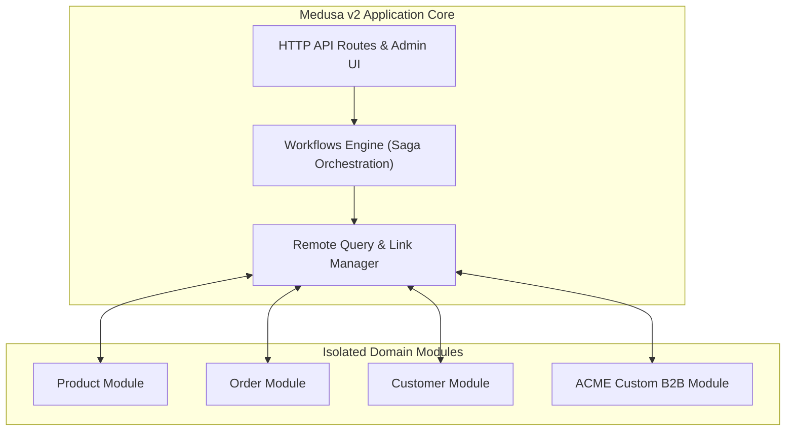

# 01. Medusa v2 코어 아키텍처 심층 분석

## 🎯 학습 목표 (Goal)
- Medusa v2의 4대 핵심 아키텍처 축(독립 모듈, DML, Remote Link & Query, Workflows 엔진)의 내부 메커니즘을 이해합니다.
- 기존 모놀리식 커머스 플랫폼과의 차별점 및 엔터프라이즈 확장 전략을 습득합니다.

---

## 💡 핵심 개념 (Core Concepts)

### 1. 모듈러 아키텍처 (Modular Architecture)
기존 이커머스 솔루션은 모든 테이블(상품, 주문, 결제, 재고)이 하나의 거대한 ORM 컨텍스트에 얽혀 있어 비즈니스 요구사항 변경 시 부작용(Side Effect)이 발생하기 쉽습니다.
Medusa v2는 **도메인 주도 설계(Domain-Driven Design)** 원칙에 따라 각 비즈니스 영역을 **완전히 격리된 모듈(Module)**로 분리합니다.
- **Product Module**: 상품 카탈로그, 옵션, 카테고리만 담당.
- **Cart & Order Module**: 장바구니 및 주문 라이프사이클만 관리.
- **Custom B2B Module**: 기업 고객, 거래처 여신 한도, 세금계산서 관리 등 커스텀 도메인 격리.

  <picture>
    <source media="(prefers-color-scheme: dark)" srcset="images/01-medusa-architecture-dark.svg">
    
  </picture>

🔍 <b>Mermaid 원본 소스 코드 보기</b> (클릭하여 펼치기)

### 2. DML (Data Modeling Language)
ORM 매핑 설정(TypeORM, Prisma 등)의 복잡한 보일러플레이트를 줄이기 위해, Medusa v2는 직관적인 TypeScript 선언형 문법인 **DML**을 채택했습니다.
- 스키마 정의 코드가 곧 데이터베이스 테이블 생성 및 TypeScript 정적 타입의 단일 진실 공급원(Single Source of Truth)이 됩니다.
- 마이그레이션 생성 시 DML 모델을 자동 분석하여 마이그레이션 SQL 파일을 생성합니다.

### 3. Remote Link와 Remote Query
모듈이 서로 완전히 분리되어 있다면, "고객(Customer Module)이 속한 기업(B2B Module)의 주문 목록(Order Module)"은 어떻게 조회할까요?
- **Module Link**: 모듈 간의 외래 키(Foreign Key) 결합을 배제하고, 두 모듈의 식별자(ID)를 연결하는 별도의 링크 테이블을 가상으로 생성합니다.
- **Remote Query**: GraphQL 스타일의 그래프 탐색 엔진으로, 단 한 번의 호출로 분산된 모듈의 데이터를 메모리 레벨에서 병합(Join)하여 반환합니다.

### 4. Workflows 엔진 (Saga 패턴 기반 오케스트레이션)
결제, 재고 차감, 주문 생성과 같은 복합 비즈니스 로직에서 중간에 결제 승인이 실패하면 이미 차감된 재고는 어떻게 원복할까요?
- Medusa v2의 Workflows는 **Saga 패턴**을 기반으로 동작합니다.
- 모든 Step은 **실행 함수(Execution)**와 **보상 함수(Compensation)**를 쌍으로 가집니다.
- 파이프라인의 5번째 단계에서 오류가 발생하면, 앞선 1~4단계의 보상 함수가 역순으로 자동 호출되어 데이터 무결성을 보장합니다.

---

## 🔍 핵심 동작 비교 분석

| 아키텍처 요소 | 전통적 커머스 (Shopify / Medusa v1) | Medusa v2 모던 아키텍처 |
| :--- | :--- | :--- |
| **데이터 모델 확장** | 메타필드(Metafields) JSON 또는 단일 DB 테이블 강제 결합 | DML 기반 독립 모듈 생성 및 Remote Link 매핑 |
| **트랜잭션 관리** | 단일 DB ACID 트랜잭션 의존 (분산 환경 확장 한계) | Workflows 엔진을 통한 Saga 분산 보상 트랜잭션 |
| **어드민 확장** | Iframe 임베드 또는 별도 웹앱 개발 | 백엔드 코드베이스 내 Vite 기반 UI 컴포넌트 직접 주입 |
| **비동기 작업** | 모놀리스 프로세스 내 Cron/인라인 처리 | Redis Event Bus + Subscribers 기반 이벤트 주도 설계 |

---

## 🏁 마무리 및 다음 단계
Medusa v2의 설계 철학을 이해했다면, 이제 실제 코드로 구현해 볼 차례입니다.

다음 단계인 [02-first-medusa-project.md](02-first-medusa-project.md)에서는 공식 CLI를 사용해 ACME 커머스 프로젝트를 초기화하고, 생성된 파일들의 역할과 `medusa-config.ts`의 설정 구조를 단계별로 분석합니다.

