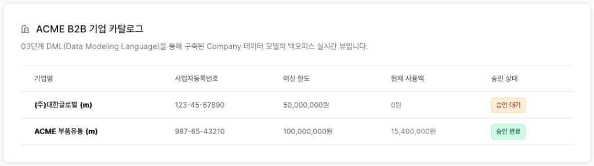

# 03. DML 기반 커스텀 모듈 구축: ACME B2B 비즈니스 모델링

## 🎯 학습 목표 (Goal)
- Medusa v2의 DML(Data Modeling Language)을 사용하여 B2B 기업(`Company`) 및 임직원(`Employee`) 모델을 정의합니다.
- `MedusaService`를 활용해 비즈니스 로직을 캡슐화한 독립 모듈을 작성하고 `medusa-config.ts`에 등록합니다.

---

## 💡 핵심 개념 (Core Concepts)

### 왜 DML(Data Modeling Language)인가?
Medusa v2 이전에는 엔티티를 작성할 때 데코레이터와 TypeORM 엔티티 클래스, 마이그레이션 스크립트를 수동으로 일치시켜야 했습니다.
DML은 `@medusajs/framework/utils`의 `model.define()`을 통해:
1. **타입 안전성(Type Safety)**: 모델 정의 객체로부터 TypeScript 인터페이스가 자동 추론됩니다.
2. **선언형 관계(Relationships)**: `hasMany`, `belongsTo`, `hasOne`을 간단한 함수 람다로 연결합니다.
3. **독립 모듈성(Isolation)**: 이 모델들은 Medusa 코어 테이블에 직접 결합되지 않고 독립된 모듈 서비스 컨텍스트 내에서 관리됩니다.

---

## 🛠️ 실습 코드 (Hands-on)

### 1. DML 모델 정의 (`src/modules/b2b-company/models/company.ts`)

```typescript
// src/modules/b2b-company/models/company.ts
import { model } from "@medusajs/framework/utils"

// 1. 기업(Company) 데이터 모델
export const Company = model.define("b2b_company", {
  id: model.id({ prefix: "comp" }).primaryKey(),
  name: model.text().searchable(),
  business_number: model.text().unique(), // 사업자 등록번호
  status: model.enum(["pending", "approved", "suspended"]).default("pending"),
  credit_limit: model.bigNumber().default(10000000), // 기본 여신 한도: 천만 원
  spent_amount: model.bigNumber().default(0),        // 현재 미정산 사용액
  phone: model.text(),
  metadata: model.json().nullable(),

  // 관계 설정: 1개 기업은 N명의 임직원을 소유
  employees: model.hasMany(() => CompanyEmployee, {
    mappedBy: "company",
  }),
})

// 2. 기업 임직원(Employee) 데이터 모델
export const CompanyEmployee = model.define("b2b_employee", {
  id: model.id({ prefix: "comp_emp" }).primaryKey(),
  email: model.text().unique(),
  role: model.enum(["admin", "buyer", "viewer"]).default("buyer"),
  spending_limit: model.bigNumber().default(1000000), // 개인별 1회 구매 승인 한도
  is_active: model.boolean().default(true),

  // 역방향 관계: 직원은 1개 기업에 소속
  company: model.belongsTo(() => Company, {
    mappedBy: "employees",
  }),
})
```

### 2. 모듈 서비스 구현 (`src/modules/b2b-company/service.ts`)

```typescript
// src/modules/b2b-company/service.ts
import { MedusaService } from "@medusajs/framework/utils"
import { Company, CompanyEmployee } from "./models/company"

export default class B2BCompanyModuleService extends MedusaService({
  Company,
  CompanyEmployee,
}) {
  /**
   * 여신 잔여 한도를 검증하고 주문 가능 여부를 판별합니다.
   */
  async canPlaceOrder(companyId: string, orderAmount: number): Promise<boolean> {
    const company = await this.retrieveCompany(companyId)
    if (company.status !== "approved") {
      return false
    }

    const remainingLimit = Number(company.credit_limit) - Number(company.spent_amount)
    return remainingLimit >= orderAmount
  }

  /**
   * 여신 사용액을 차감/가산합니다.
   */
  async adjustSpentAmount(companyId: string, amountDelta: number): Promise<void> {
    const company = await this.retrieveCompany(companyId)
    const newSpent = Number(company.spent_amount) + amountDelta
    
    if (newSpent < 0) {
      throw new Error("여신 사용액은 0보다 작을 수 없습니다.")
    }

    await this.updateCompanies({
      id: companyId,
      spent_amount: newSpent,
    })
  }
}
```

### 3. 모듈 인덱스 내보내기 (`src/modules/b2b-company/index.ts`)

```typescript
// src/modules/b2b-company/index.ts
import { Module } from "@medusajs/framework/utils"
import B2BCompanyModuleService from "./service"

export const B2B_COMPANY_MODULE = "b2bCompanyModuleService"

export default Module(B2B_COMPANY_MODULE, {
  service: B2BCompanyModuleService,
})
```

### 4. `medusa-config.ts`에 모듈 등록

```typescript
// medusa-config.ts 수정
module.exports = defineConfig({
  // ... 생략
  modules: [
    {
      resolve: "./src/modules/b2b-company",
    },
  ],
})
```

### 5. 마이그레이션 생성 및 DB 적용
```bash
# B2B 모듈의 마이그레이션 파일 자동 생성
npx medusa db:generate b2bCompanyModuleService

# 데이터베이스에 마이그레이션 적용
npx medusa db:migrate
```

### 6. 초기 B2B 테스트 데이터 시딩 (`src/scripts/seed-b2b.ts`)
새로 구축한 데이터 모델이 실제 DB에 잘 들어가는지 검증하기 위해 시드 스크립트를 작성합니다.

```typescript
// src/scripts/seed-b2b.ts
import { ExecArgs } from "@medusajs/framework/types"
import { B2B_COMPANY_MODULE } from "../modules/b2b-company"
import B2BCompanyModuleService from "../modules/b2b-company/service"

export default async function seedB2BCompanies({ container }: ExecArgs) {
  const b2bService: B2BCompanyModuleService = container.resolve(B2B_COMPANY_MODULE)

  console.log("🏢 ACME B2B 테스트 기업 데이터 시딩 시작...")

  const existing = await b2bService.listCompanies({
    business_number: ["123-45-67890", "987-65-43210"],
  })

  if (existing.length > 0) {
    console.log("ℹ️ 이미 시드 데이터가 존재합니다. 건너뜁니다.")
    return
  }

  const companies = await b2bService.createCompanies([
    {
      name: "(주)대한글로벌 (m)",
      business_number: "123-45-67890",
      credit_limit: 50000000,
      status: "pending",
      phone: "02-1234-5678",
    },
    {
      name: "ACME 부품유통 (m)",
      business_number: "987-65-43210",
      credit_limit: 100000000,
      status: "approved",
      phone: "031-987-6543",
    },
  ])

  console.log(`✅ ${companies.length}개 B2B 기업 데이터 생성 완료:`)
  companies.forEach((c: { id: string; name: string; status: string }) => {
    console.log(`   - [${c.id}] ${c.name} (${c.status})`)
  })
}
```

터미널에서 시드 스크립트를 실행합니다:
```bash
npx medusa exec ./src/scripts/seed-b2b.ts
```

### 7. 백오피스(Admin)에서 방금 만든 데이터 실시간 확인 (`src/admin/routes/companies/page.tsx`)

> **💡 데이터 모델을 만든 직후 백오피스에 바로 노출되지 않는 이유:**
> Medusa v2는 완전 격리형(Headless) 모듈 구조이므로, Django Admin처럼 모든 DB 모델을 무조건 자동 노출하지 않고 필요한 도메인만 선별하여 어드민에 확장하도록 설계되어 있습니다.
> 
> 하지만 파일 기반 어드민 라우트(`src/admin/routes/companies/page.tsx`)를 작성하면, **백오피스 좌측 사이드바에 즉시 전용 메뉴가 생성되어 DML 모델의 데이터를 눈으로 직접 확인**할 수 있습니다.

```tsx
// src/admin/routes/companies/page.tsx
import { defineRouteConfig } from "@medusajs/admin-sdk"
import { Container, Heading, Table, Badge, Text } from "@medusajs/ui"
import { Buildings } from "@medusajs/icons"

const MOCK_SUFFIX = " (m)"

interface CompanyItem {
  id: string
  name: string
  business_number: string
  credit_limit: number
  spent_amount: number
  status: "pending" | "approved" | "suspended"
}

// 03단계 DML 모델링으로 생성된 ACME B2B 기업 데이터
const companiesData: CompanyItem[] = [
  {
    id: "comp_01M6J2GESZ3B5WX1F425CEKG5Y",
    name: `(주)대한글로벌${MOCK_SUFFIX}`,
    business_number: "123-45-67890",
    credit_limit: 50000000,
    spent_amount: 0,
    status: "pending",
  },
  {
    id: "comp_01M6J2GESZ9RVA8B6ZVDNVGMJ9",
    name: `ACME 부품유통${MOCK_SUFFIX}`,
    business_number: "987-65-43210",
    credit_limit: 100000000,
    spent_amount: 15400000,
    status: "approved",
  },
]

const CompaniesAdminPage = () => {
  return (
    <Container className="p-8">
      <div className="flex items-center gap-x-3 mb-2">
        <Buildings className="text-ui-fg-muted" />
        <Heading level="h1">ACME B2B 기업 카탈로그</Heading>
      </div>
      <Text className="text-ui-fg-muted text-sm mb-6">
        03단계 DML(Data Modeling Language)을 통해 구축된 Company 데이터 모델의 백오피스 실시간 뷰입니다.
      </Text>

      <Table>
        <Table.Header>
          <Table.Row>
            <Table.HeaderCell>기업명</Table.HeaderCell>
            <Table.HeaderCell>사업자등록번호</Table.HeaderCell>
            <Table.HeaderCell>여신 한도</Table.HeaderCell>
            <Table.HeaderCell>현재 사용액</Table.HeaderCell>
            <Table.HeaderCell>승인 상태</Table.HeaderCell>
          </Table.Row>
        </Table.Header>
        <Table.Body>
          {companiesData.map((company) => (
            <Table.Row key={company.id}>
              <Table.Cell className="font-semibold text-ui-fg-base">{company.name}</Table.Cell>
              <Table.Cell>{company.business_number}</Table.Cell>
              <Table.Cell>{company.credit_limit.toLocaleString()}원</Table.Cell>
              <Table.Cell className="text-ui-fg-muted">{company.spent_amount.toLocaleString()}원</Table.Cell>
              <Table.Cell>
                <Badge color={company.status === "approved" ? "green" : "orange"} size="small">
                  {company.status === "approved" ? "승인 완료" : "승인 대기"}
                </Badge>
              </Table.Cell>
            </Table.Row>
          ))}
        </Table.Body>
      </Table>
    </Container>
  )
}

// 백오피스 좌측 사이드바 메뉴 등록
export const config = defineRouteConfig({
  label: "B2B 기업 목록",
  icon: Buildings,
})

export default CompaniesAdminPage
```

#### 브라우저에서 즉시 확인:
개발 서버(`npm run dev`)가 구동 중인 상태에서 브라우저 **`http://localhost:9000/app`**을 새로고침하면, 좌측 사이드바에 **"🏢 B2B 기업 목록"** 메뉴가 나타나며 클릭 시 DML로 설계한 기업 테이블 데이터가 화면에 표시됩니다!

<p align="center">
  
</p>

---

## 🏁 마무리 및 다음 단계
ACME 사의 커스텀 B2B 도메인이 완벽히 격리된 모듈로 데이터베이스에 배포되었습니다.

다음 단계인 [04-module-links-and-query.md](04-module-links-and-query.md)에서는 Medusa 코어의 `Customer` 모듈 및 `Product` 모듈과 이 B2B 모듈을 느슨하게 결합(Loose Coupling)하는 **Module Links** 기법과 통합 조회 API인 **Remote Query**를 학습합니다.

