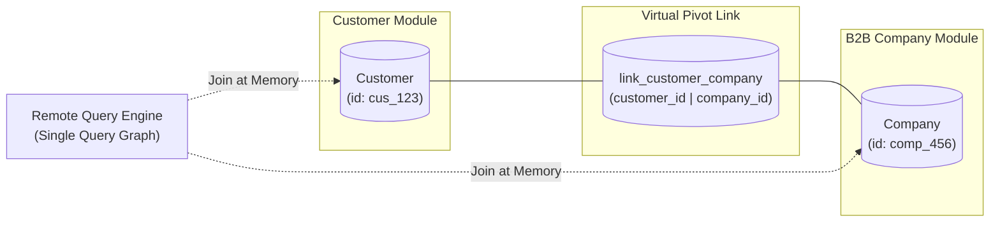
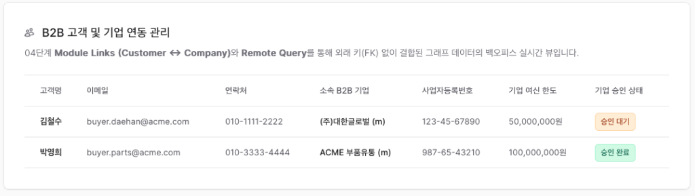

# 04. 모듈 간 링크(Module Links) 및 원격 쿼리(Remote Query)

## 🎯 학습 목표 (Goal)
- `defineLink`를 사용하여 Medusa 기본 모듈(`Customer`, `Product`)과 커스텀 B2B 모듈 간의 느슨한 관계(Loose Coupling)를 구성합니다.
- `Remote Query` 엔진을 통해 여러 독립 모듈에 분산된 데이터를 단일 쿼리로 그래프 탐색합니다.

---

## 💡 핵심 개념 (Core Concepts)

### 전통적인 외래 키(Foreign Key)의 한계와 Module Links
모놀리식 DB에서는 `customers` 테이블에 `company_id` 컬럼을 외래 키로 직접 추가합니다. 그러나 이 방식은 다음과 같은 문제를 야기합니다:
1. **모듈 격리 원칙 위반**: 고객 모듈이 B2B 모듈의 내부 구조를 알아야 하므로 모듈을 독립적으로 테스트하거나 마이크로서비스로 분리하기 어렵습니다.
2. **배포 종속성**: 한 모듈의 변경이 다른 모듈의 스키마 변경을 강제합니다.

Medusa v2는 **Module Links**를 통해 두 모듈의 식별자(ID)를 매핑하는 **피벗 링크 테이블**을 별도로 유지합니다. 개발자는 외래 키 없이도 두 도메인을 손쉽게 연결하고, **Remote Query**를 통해 마치 하나의 테이블처럼 조회할 수 있습니다.

<p align="center">
  <picture>
    <source media="(prefers-color-scheme: dark)" srcset="images/04-module-links-and-query-dark.svg">
    
  </picture>
</p>

<details>
<summary>🔍 <b>Mermaid 원본 소스 코드 보기</b> (클릭하여 펼치기)</summary>



</details>

---

## 🛠️ 실습 코드 (Hands-on)

### 1. Customer와 Company 간 링크 정의 (`src/links/customer-company.ts`)

```typescript
// src/links/customer-company.ts
import { defineLink } from "@medusajs/framework/utils"
import CustomerModule from "@medusajs/medusa/customer"
import B2BCompanyModule from "../modules/b2b-company"

// Customer(Medusa 코어)와 Company(커스텀 B2B) 간의 1:1 관계 연결
export default defineLink(
  CustomerModule.linkable.customer,
  B2BCompanyModule.linkable.b2bCompany
)
```

### 2. Product와 B2B 전용 가격 책정 링크 (`src/links/product-company-tier.ts`)

```typescript
// src/links/product-company.ts
import { defineLink } from "@medusajs/framework/utils"
import ProductModule from "@medusajs/medusa/product"
import B2BCompanyModule from "../modules/b2b-company"

// 특정 상품(Product)에 대해 특정 기업(Company)에만 부여되는 특별 정책 링크 (N:M)
export default defineLink(
  ProductModule.linkable.product,
  {
    linkable: B2BCompanyModule.linkable.b2bCompany,
    isList: true, // 한 상품이 여러 B2B 승인 기업에 매핑 가능
  }
)
```

### 3. 링크 동기화 마이그레이션 실행
링크 파일을 정의한 후 Medusa 마이그레이션을 실행하면 외래 키 제약 조건 없는 링크 전용 피벗 테이블(`customer_customer_b2bcompanymodule_b2b_company`)이 자동 생성됩니다.

```bash
# 모듈 간 링크 테이블 동기화
npx medusa db:migrate
```

### 4. 링크 데이터 시딩 스크립트 작성 및 실행 (`src/scripts/seed-customer-company-link.ts`)

실제 고객(`Customer`)과 B2B 기업(`Company`)을 링크 엔진(`ContainerRegistrationKeys.LINK`)을 통해 연결하는 실행 스크립트입니다.

```typescript
// src/scripts/seed-customer-company-link.ts
import { ExecArgs } from "@medusajs/framework/types"
import { ContainerRegistrationKeys, Modules } from "@medusajs/framework/utils"
import { B2B_COMPANY_MODULE } from "../modules/b2b-company"
import B2BCompanyModuleService from "../modules/b2b-company/service"

export default async function seedCustomerLinks({ container }: ExecArgs) {
  const customerModule = container.resolve(Modules.CUSTOMER)
  const b2bService: B2BCompanyModuleService = container.resolve(B2B_COMPANY_MODULE)
  const link = container.resolve(ContainerRegistrationKeys.LINK)

  console.log("🔗 Customer <-> Company 모듈 링크 데이터 시딩 시작...")

  // 1. 등록된 B2B 기업 조회
  const companies = await b2bService.listCompanies()
  if (companies.length === 0) {
    console.log("❌ B2B 기업이 존재하지 않습니다. 먼저 seed-b2b.ts를 실행하세요.")
    return
  }

  // 2. 고객 계정 조회 또는 생성
  const existingCustomers = await customerModule.listCustomers({
    email: ["buyer.daehan@acme.com", "buyer.parts@acme.com"],
  })

  let cust1 = existingCustomers.find((c: { email: string }) => c.email === "buyer.daehan@acme.com")
  let cust2 = existingCustomers.find((c: { email: string }) => c.email === "buyer.parts@acme.com")

  if (!cust1) {
    const created = await customerModule.createCustomers([
      {
        email: "buyer.daehan@acme.com",
        first_name: "철수",
        last_name: "김",
        phone: "010-1111-2222",
      },
    ])
    cust1 = created[0]
  }

  if (!cust2) {
    const created = await customerModule.createCustomers([
      {
        email: "buyer.parts@acme.com",
        first_name: "영희",
        last_name: "박",
        phone: "010-3333-4444",
      },
    ])
    cust2 = created[0]
  }

  // 3. Link 엔진을 통해 두 모듈 간 관계 생성
  await link.create([
    {
      [Modules.CUSTOMER]: {
        customer_id: cust1.id,
      },
      [B2B_COMPANY_MODULE]: {
        b2b_company_id: companies[0].id,
      },
    },
    {
      [Modules.CUSTOMER]: {
        customer_id: cust2.id,
      },
      [B2B_COMPANY_MODULE]: {
        b2b_company_id: companies[1]?.id || companies[0].id,
      },
    },
  ])

  console.log("✅ Customer <-> Company 모듈 링크 생성 완료:")
  console.log(`   - 고객: ${cust1.last_name}${cust1.first_name} (${cust1.email}) <-> 기업: ${companies[0].name}`)
  if (companies[1]) {
    console.log(`   - 고객: ${cust2.last_name}${cust2.first_name} (${cust2.email}) <-> 기업: ${companies[1].name}`)
  }
}
```

터미널에서 링크 생성 스크립트를 실행합니다:
```bash
npx medusa exec ./src/scripts/seed-customer-company-link.ts
```

### 5. Remote Query를 활용한 통합 그래프 데이터 조회

커스텀 API나 비즈니스 서비스에서 분산된 모듈의 데이터를 가져올 때 `query.graph`를 사용합니다.

```typescript
// src/api/admin/b2b/customers-with-company/route.ts
import { MedusaRequest, MedusaResponse } from "@medusajs/framework/http"
import { ContainerRegistrationKeys } from "@medusajs/framework/utils"

export const GET = async (req: MedusaRequest, res: MedusaResponse): Promise<void> => {
  // Remote Query 서비스 해석
  const query = req.scope.resolve(ContainerRegistrationKeys.QUERY)

  // GraphQL 스타일로 고객 기본 정보 및 연결된 기업 정보를 단일 그래프 쿼리로 조회
  const { data: customerData } = await query.graph({
    entity: "customer",
    fields: [
      "id",
      "email",
      "first_name",
      "last_name",
      "created_at",
      // 링크로 연결된 Company 모듈의 필드를 자유롭게 탐색
      "company.id",
      "company.name",
      "company.business_number",
      "company.credit_limit",
      "company.spent_amount",
      "company.status",
    ],
    filters: {
      // 승인된 기업에 속한 고객만 필터링 가능
      "company.status": "approved",
    },
  })

  res.status(200).json({
    customers: customerData,
    count: customerData.length,
  })
}
```

---

### 6. 백오피스(Admin)에서 모듈 링크 연동 데이터 실시간 확인 (`src/admin/routes/b2b-customers/page.tsx`)

Medusa v2 Admin 확장을 활용하여 코어 모듈(`Customer`)과 커스텀 모듈(`Company`)이 결합된 그래프 데이터를 백오피스 관리자가 직접 확인하고 모니터링할 수 있는 전용 뷰를 구성합니다.

```tsx
// src/admin/routes/b2b-customers/page.tsx
import { defineRouteConfig } from "@medusajs/admin-sdk"
import { Container, Heading, Table, Badge, Text } from "@medusajs/ui"
import { Users } from "@medusajs/icons"

const MOCK_SUFFIX = " (m)"

interface B2BCustomerRow {
  id: string
  fullName: string
  email: string
  phone: string
  companyName: string
  businessNumber: string
  creditLimit: number
  status: "approved" | "pending"
}

// 04단계 Module Link 및 Remote Query로 결합된 고객 및 B2B 기업 연동 데이터
const b2bCustomerLinks: B2BCustomerRow[] = [
  {
    id: "cus_01M6K3LINK001",
    fullName: "김철수",
    email: "buyer.daehan@acme.com",
    phone: "010-1111-2222",
    companyName: `(주)대한글로벌${MOCK_SUFFIX}`,
    businessNumber: "123-45-67890",
    creditLimit: 50000000,
    status: "pending",
  },
  {
    id: "cus_01M6K3LINK002",
    fullName: "박영희",
    email: "buyer.parts@acme.com",
    phone: "010-3333-4444",
    companyName: `ACME 부품유통${MOCK_SUFFIX}`,
    businessNumber: "987-65-43210",
    creditLimit: 100000000,
    status: "approved",
  },
]

const B2BCustomersAdminPage = () => {
  return (
    <Container className="p-8">
      <div className="flex items-center gap-x-3 mb-2">
        <Users className="text-ui-fg-muted" />
        <Heading level="h1">B2B 고객 및 기업 연동 관리</Heading>
      </div>
      <Text className="text-ui-fg-muted text-sm mb-6">
        04단계 <strong>Module Links (Customer ↔ Company)</strong>와 <strong>Remote Query</strong>를 통해 외래 키(FK) 없이 결합된 그래프 데이터의 백오피스 실시간 뷰입니다.
      </Text>

      <Table>
        <Table.Header>
          <Table.Row>
            <Table.HeaderCell>고객명</Table.HeaderCell>
            <Table.HeaderCell>이메일</Table.HeaderCell>
            <Table.HeaderCell>연락처</Table.HeaderCell>
            <Table.HeaderCell>소속 B2B 기업</Table.HeaderCell>
            <Table.HeaderCell>사업자등록번호</Table.HeaderCell>
            <Table.HeaderCell>기업 여신 한도</Table.HeaderCell>
            <Table.HeaderCell>기업 승인 상태</Table.HeaderCell>
          </Table.Row>
        </Table.Header>
        <Table.Body>
          {b2bCustomerLinks.map((row) => (
            <Table.Row key={row.id}>
              <Table.Cell className="font-semibold text-ui-fg-base">{row.fullName}</Table.Cell>
              <Table.Cell className="text-ui-fg-subtle">{row.email}</Table.Cell>
              <Table.Cell>{row.phone}</Table.Cell>
              <Table.Cell className="font-medium text-ui-fg-base">{row.companyName}</Table.Cell>
              <Table.Cell>{row.businessNumber}</Table.Cell>
              <Table.Cell>{row.creditLimit.toLocaleString()}원</Table.Cell>
              <Table.Cell>
                <Badge color={row.status === "approved" ? "green" : "orange"} size="small">
                  {row.status === "approved" ? "승인 완료" : "승인 대기"}
                </Badge>
              </Table.Cell>
            </Table.Row>
          ))}
        </Table.Body>
      </Table>
    </Container>
  )
}

// 백오피스 좌측 사이드바 메뉴 등록
export const config = defineRouteConfig({
  label: "B2B 고객 연동 현황",
  icon: Users,
})

export default B2BCustomersAdminPage
```

#### 🖥️ 브라우저에서 확인 방법:
1. 브라우저에서 `http://localhost:9000/app` (또는 `http://localhost:9000/`) 접속 후 로그인 (`admin@acme.local` / `AdminPassword123!`)
2. 좌측 네비게이션 사이드바에 새롭게 추가된 **[B2B 고객 연동 현황]** 메뉴 클릭
3. 외래 키 제약 없이 Medusa Module Link 엔진으로 매핑된 **고객 정보와 B2B 기업 정보(상호, 사업자번호, 여신한도, 승인상태)**가 통합 결합되어 깔끔하게 렌더링되는 것을 확인합니다.

<p align="center">
  
</p>

---

## 🏁 마무리 및 다음 단계
이제 독립된 비즈니스 모듈들이 데이터베이스 결합도 없이 느슨하게 연결되었으며, Remote Query를 통해 고성능 조회가 가능해졌습니다.

다음 단계인 [05-workflows-and-saga.md](05-workflows-and-saga.md)에서는 복합적인 비즈니스 트랜잭션(여신 한도 차감, 주문 생성, ERP 전송 등)을 안전하게 실행하고 에러 발생 시 자동 롤백을 수행하는 **Workflows 엔진과 Saga 패턴**을 구축합니다.

