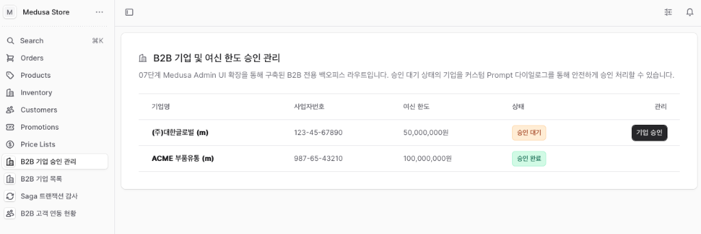
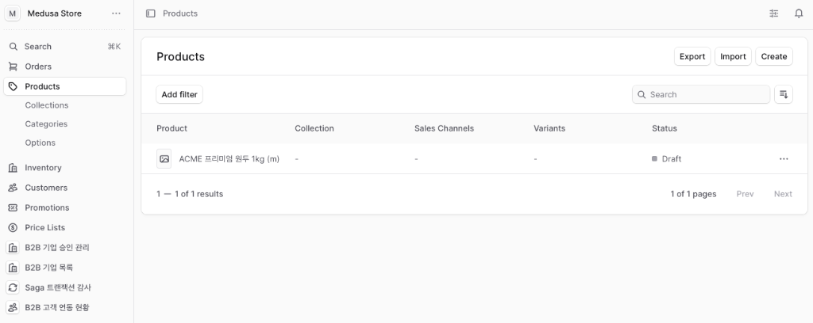

# 07. Medusa Admin 백오피스 커스터마이징 및 UI 확장

## 🎯 학습 목표 (Goal)
- Medusa Admin의 UI 확장 프레임워크(`@medusajs/admin-sdk`, `@medusajs/ui`)를 이해합니다.
- 기존 상품 상세 화면에 B2B 위젯(Widget)을 주입하고, 전용 B2B 기업 승인 관리 페이지를 제작합니다.
- 프론트엔드 작업 시 안전한 모달 다이얼로그 및 TypeScript 타입 규칙을 준수합니다.

---

## 💡 핵심 개념 (Core Concepts)

### 왜 백엔드 저장소 안에 Admin UI가 함께 위치하는가?
Medusa v2는 **Vite 기반의 Admin UI 컴파일러**를 내장하고 있어, 별도의 프론트엔드 레포지토리를 파지 않고도 `src/admin/` 폴더에 React 컴포넌트를 작성하는 것만으로 대시보드에 즉시 주입됩니다.
- **Widgets**: 상품 상세, 주문 상세, 고객 상세 화면의 특정 영역(`product.details.before`, `order.details.after` 등)에 자동으로 컴포넌트를 마운트합니다.
- **Custom Pages**: `/app/b2b`와 같은 전용 어드민 메뉴와 라우트를 추가합니다.
- **디자인 시스템**: Medusa 공식 디자인 시스템인 `@medusajs/ui`를 통해 일관된 룩앤필을 보장합니다.

---

## 🛠️ 실습 코드 (Hands-on)

### 1. 상품 상세 화면에 B2B 전용 위젯 주입 (`src/admin/widgets/product-b2b-tier.tsx`)

```tsx
// src/admin/widgets/product-b2b-tier.tsx
import { defineWidgetConfig } from "@medusajs/admin-sdk"
import { Badge, Container, Heading, Text, Button } from "@medusajs/ui"
import { DetailWidgetProps, AdminProduct } from "@medusajs/framework/types"
import { useState } from "react"

// 목(Mock) 데이터 식별 상수 (운영 규칙 준수)
const MOCK_SUFFIX = " (m)"

const ProductB2BWidget = ({ data }: DetailWidgetProps<AdminProduct>) => {
  const [tierName, setTierName] = useState<string>(`엔터프라이즈 골드 등급${MOCK_SUFFIX}`)
  const [isUpdating, setIsUpdating] = useState<boolean>(false)

  const handleTierRefresh = () => {
    setIsUpdating(true)
    // 비즈니스 로직 시뮬레이션
    setTimeout(() => {
      setTierName(`엔터프라이즈 플래티넘 등급${MOCK_SUFFIX}`)
      setIsUpdating(false)
    }, 600)
  }

  return (
    <Container className="p-6 bg-ui-bg-subtle border border-ui-border-base rounded-lg mb-4">
      <div className="flex items-center justify-between">
        <div>
          <Heading level="h2" className="text-ui-fg-base text-base font-semibold">
            ACME B2B 공급 등급 설정
          </Heading>
          <Text className="text-ui-fg-muted text-sm mt-1">
            상품 ID: {data.id} | 등록일: {data.created_at ? new Date(data.created_at).toLocaleDateString("ko-KR") : "-"}
          </Text>
        </div>
        <Badge color="blue" size="base">
          {tierName}
        </Badge>
      </div>

      <div className="mt-4 pt-4 border-t border-ui-border-base flex justify-end">
        <Button
          variant="secondary"
          size="small"
          isLoading={isUpdating}
          onClick={handleTierRefresh}
        >
          등급 갱신
        </Button>
      </div>
    </Container>
  )
}

// 위젯이 주입될 위치: 상품 상세 페이지 메인 콘텐츠 상단
export const config = defineWidgetConfig({
  zone: "product.details.before",
})

export default ProductB2BWidget
```

### 2. B2B 기업 승인 전용 페이지 및 커스텀 확인 다이얼로그 (`src/admin/routes/b2b/page.tsx`)

> **[주의] 브라우저 기본 `window.confirm()` 또는 `alert()` 사용은 엄격히 금지됩니다.**
> 대화형 UI에는 반드시 `@medusajs/ui`의 `Prompt` 컴포넌트 또는 커스텀 다이얼로그를 사용해야 합니다.

```tsx
// src/admin/routes/b2b/page.tsx
import { defineRouteConfig } from "@medusajs/admin-sdk"
import { Container, Heading, Table, Badge, Button, Prompt } from "@medusajs/ui"
import { Buildings } from "@medusajs/icons"
import { useState } from "react"

interface B2BCompanyRecord {
  id: string
  name: string
  business_number: string
  credit_limit: number
  status: "pending" | "approved" | "suspended"
}

// 초기 목 데이터 (운영 규칙에 따른 (m) 표기 적용)
const MOCK_SUFFIX = " (m)"

const initialCompanies: B2BCompanyRecord[] = [
  {
    id: "comp_01",
    name: `(주)대한글로벌${MOCK_SUFFIX}`,
    business_number: "123-45-67890",
    credit_limit: 50000000,
    status: "pending",
  },
  {
    id: "comp_02",
    name: `ACME 부품유통${MOCK_SUFFIX}`,
    business_number: "987-65-43210",
    credit_limit: 100000000,
    status: "approved",
  },
]

const B2BCompanyAdminPage = () => {
  const [companies, setCompanies] = useState<B2BCompanyRecord[]>(initialCompanies)
  const [selectedCompanyId, setSelectedCompanyId] = useState<string | null>(null)
  const [isPromptOpen, setIsPromptOpen] = useState<boolean>(false)

  // 승인 다이얼로그 열기
  const handleOpenApprovePrompt = (id: string) => {
    setSelectedCompanyId(id)
    setIsPromptOpen(true)
  }

  // 승인 확정 액션
  const handleConfirmApproval = () => {
    if (!selectedCompanyId) return

    setCompanies((prev) =>
      prev.map((c) =>
        c.id === selectedCompanyId ? { ...c, status: "approved" as const } : c
      )
    )
    setIsPromptOpen(false)
    setSelectedCompanyId(null)
  }

  return (
    <Container className="p-8">
      <div className="flex items-center gap-x-3 mb-6">
        <Buildings className="text-ui-fg-muted" />
        <Heading level="h1">B2B 기업 및 여신 한도 관리</Heading>
      </div>

      <Table>
        <Table.Header>
          <Table.Row>
            <Table.HeaderCell>기업명</Table.HeaderCell>
            <Table.HeaderCell>사업자번호</Table.HeaderCell>
            <Table.HeaderCell>여신 한도</Table.HeaderCell>
            <Table.HeaderCell>상태</Table.HeaderCell>
            <Table.HeaderCell className="text-right">관리</Table.HeaderCell>
          </Table.Row>
        </Table.Header>
        <Table.Body>
          {companies.map((company) => (
            <Table.Row key={company.id}>
              <Table.Cell className="font-medium">{company.name}</Table.Cell>
              <Table.Cell>{company.business_number}</Table.Cell>
              <Table.Cell>{company.credit_limit.toLocaleString()}원</Table.Cell>
              <Table.Cell>
                <Badge color={company.status === "approved" ? "green" : "orange"}>
                  {company.status === "approved" ? "승인 완료" : "승인 대기"}
                </Badge>
              </Table.Cell>
              <Table.Cell className="text-right">
                {company.status === "pending" && (
                  <Button
                    size="small"
                    variant="primary"
                    onClick={() => handleOpenApprovePrompt(company.id)}
                  >
                    기업 승인
                  </Button>
                )}
              </Table.Cell>
            </Table.Row>
          ))}
        </Table.Body>
      </Table>

      {/* 브라우저 기본 confirm을 대체하는 커스텀 확인 다이얼로그 */}
      <Prompt open={isPromptOpen} onOpenChange={setIsPromptOpen}>
        <Prompt.Content>
          <Prompt.Header>
            <Prompt.Title>기업 승인 확인</Prompt.Title>
            <Prompt.Description>
              해당 기업의 여신 한도를 승인하시겠습니까? 승인 즉시 B2B 주문이 가능해집니다.
            </Prompt.Description>
          </Prompt.Header>
          <Prompt.Footer>
            <Prompt.Cancel onClick={() => setIsPromptOpen(false)}>
              취소
            </Prompt.Cancel>
            <Prompt.Action onClick={handleConfirmApproval}>
              승인 확정
            </Prompt.Action>
          </Prompt.Footer>
        </Prompt.Content>
      </Prompt>
    </Container>
  )
}

// 사이드바 메뉴 등록
export const config = defineRouteConfig({
  label: "B2B 기업 승인 관리",
  icon: Buildings,
})

export default B2BCompanyAdminPage
```

---

### 3. 관리자 사이트(Admin)에서 위젯 및 커스텀 페이지 실시간 테스트 (Admin UI Verification)

작성한 위젯과 커스텀 라우트가 Medusa Vite 컴파일러에 의해 실제 백오피스 대시보드에 어떻게 마운트되고 동작하는지 브라우저에서 단계별로 검증합니다.

#### 🖥️ 테스트 준비: 관리자 로그인
1. 브라우저에서 **`http://localhost:9000/app`** (또는 `http://localhost:9000/`)으로 접속합니다.
2. 02단계에서 생성한 관리자 자격 증명으로 로그인합니다:
   - **Email**: `admin@acme.local`
   - **Password**: `AdminPassword123!`

---

#### 🧪 테스트 1: B2B 기업 승인 전용 페이지 및 커스텀 Prompt 다이얼로그 검증 (`/app/b2b`)

1. **사이드바 메뉴 확인**:
   - 로그인 후 좌측 사이드바 네비게이션 메뉴를 확인합니다.
   - `Price Lists` 바로 아래에 `defineRouteConfig`에 의해 자동으로 등록된 **`[B2B 기업 승인 관리]`** 메뉴를 클릭합니다.

<p align="center">
  
</p>
<p align="center" style="color: #6b7280; font-size: 0.875rem; margin-top: -8px; margin-bottom: 24px;">
  ▲ 좌측 네비게이션 사이드바의 <b>[B2B 기업 승인 관리]</b> 메뉴 및 우측 실시간 승인 테이블 화면
</p>

2. **기업 목록 및 승인 상태 확인**:
   - `(주)대한글로벌 (m)` 기업은 주황색 **`승인 대기`** 배지와 함께 우측에 파란색 **`[기업 승인]`** 액션 버튼이 표시됩니다.
   - `ACME 부품유통 (m)` 기업은 초록색 **`승인 완료`** 배지가 표시되며 버튼이 노출되지 않습니다.

3. **커스텀 확인 모달(`Prompt`) 인터랙션 테스트**:
   - `(주)대한글로벌 (m)` 우측의 **`[기업 승인]`** 버튼을 클릭합니다.
   - 브라우저 기본 경고창(`window.confirm`) 대신, Medusa UI 디자인 시스템 표준인 **커스텀 Prompt 다이얼로그**가 화면 중앙에 오버레이로 열립니다:
     - 제목: `기업 승인 확인`
     - 본문: `해당 기업의 여신 한도를 승인하시겠습니까? 승인 즉시 B2B 주문이 가능해집니다.`
     - 버튼: `취소` / `승인 확정`
   - `[취소]` 클릭 시 다이얼로그가 닫히고 기존 상태가 유지되는지 확인합니다.

4. **승인 확정 및 상태 실시간 전환 확인**:
   - 다시 `[기업 승인]` ➡️ **`[승인 확정]`**을 클릭합니다.
   - 페이지 새로고침 없이 즉시 `(주)대한글로벌 (m)`의 상태가 초록색 **`승인 완료`** 배지로 변경되고 `[기업 승인]` 버튼이 사라지는 것을 확인합니다!

---

#### 🧪 테스트 2: 상품 상세 화면의 B2B 위젯 주입 및 실시간 갱신 검증 (`/app/products/:id`)

위젯은 Medusa 코어 페이지의 특정 영역(`product.details.before`)에 컴포넌트를 직접 삽입하므로, 상품 상세 화면으로 이동하여 검증합니다.

1. **테스트 상품 확인 (없을 경우 생성)**:
   - 좌측 메뉴에서 **`[Products]`** (`http://localhost:9000/app/products`)로 이동합니다.
   - 등록된 상품이 없다면 터미널에서 아래 명령어로 즉시 테스트 상품을 하나 생성합니다:
     ```bash
     # 관리자 토큰 발급 및 테스트 상품 1건 등록
     ADMIN_TOKEN=$(curl -s -X POST http://localhost:9000/auth/user/emailpass \
       -H "Content-Type: application/json" \
       -d '{"email":"admin@acme.local","password":"AdminPassword123!"}' \
       | node -e "let d=''; process.stdin.on('data', c=>d+=c); process.stdin.on('end', ()=>console.log(JSON.parse(d).token));")

     curl -s -X POST http://localhost:9000/admin/products \
       -H "Authorization: Bearer $ADMIN_TOKEN" \
       -H "Content-Type: application/json" \
       -d '{
         "title": "ACME 프리미엄 원두 1kg (m)",
         "description": "F&B 카페 프랜차이즈 전용 고품질 에스프레소 블렌드",
         "options": [{"title": "Default Option", "values": ["Default Variant"]}]
       }'
     ```

<p align="center">
  
</p>
<p align="center" style="color: #6b7280; font-size: 0.875rem; margin-top: -8px; margin-bottom: 24px;">
  ▲ 상품 목록(Products) 화면에서 등록된 <b>ACME 프리미엄 원두 1kg (m)</b> 확인
</p>

2. **위젯 주입 영역 확인**:
   - 상품 목록에서 방금 생성된 **`ACME 프리미엄 원두 1kg (m)`** 상품을 클릭하여 상세 페이지로 이동합니다.
   - 메인 상품 정보 상단(`product.details.before`)에 우리가 작성한 **`ACME B2B 공급 등급 설정`** 컨테이너 위젯이 완벽하게 주입되어 렌더링된 것을 확인합니다:
     - 좌측: `상품 ID` 및 `등록일` 표시
     - 우측: 파란색 `엔터프라이즈 골드 등급 (m)` 배지

3. **인터랙티브 상태 갱신 테스트**:
   - 위젯 우측 하단의 **`[등급 갱신]`** 버튼을 클릭합니다.
   - 버튼이 즉시 비활성화되며 로딩 스피너(`isLoading={true}`)가 표시됩니다.
   - 0.6초 후 배지가 실시간으로 **`엔터프라이즈 플래티넘 등급 (m)`**으로 승급 갱신되는 반응형 UI 동작을 확인합니다!

---

## 🏁 마무리 및 다음 단계
이제 운영팀이 Medusa Admin 대시보드 내에서 직접 B2B 기업 승인과 상품 정책을 제어할 수 있는 네이티브 백오피스 인터페이스가 완성되었습니다.

다음 단계인 [08-nextjs-storefront-setup.md](08-nextjs-storefront-setup.md)부터는 고객이 직접 접속하는 **Next.js 14+ App Router 기반 프론트오피스 스토어프론트 구축**에 돌입합니다.

