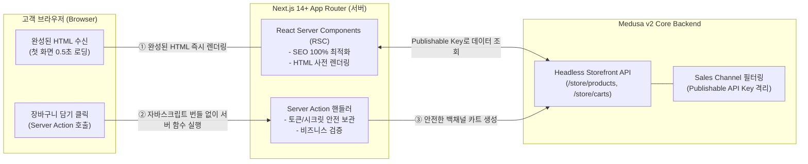
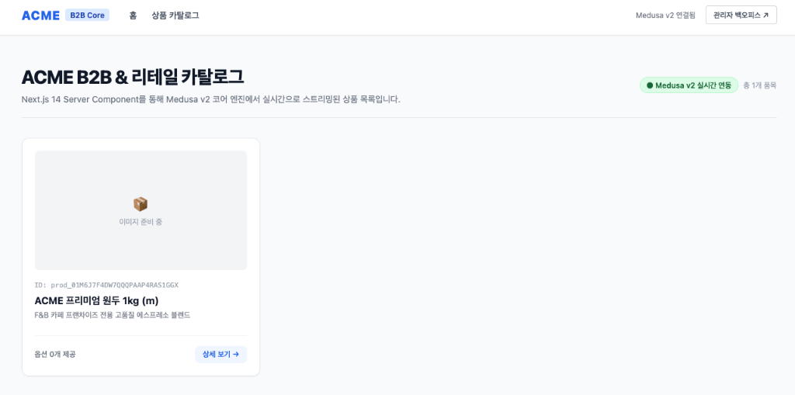

# 08. Next.js 14+ 스토어프론트 구축 및 Medusa JS SDK 연동

## 🎯 학습 목표 (Goal)
- Next.js 14+ (App Router) 환경에서 `@medusajs/js-sdk`를 설정하고 백엔드와 연결합니다.
- React Server Components(RSC)를 활용하여 고성능의 SEO 친화적인 서버 사이드 데이터 페칭을 구현합니다.

---

## 💡 핵심 개념 (Core Concepts)

### 1. 헤드리스(Headless) 커머스란 무엇인가? (현실 비유로 이해하기)

전통적인 쇼핑몰 솔루션(카페24, 쇼피파이 기본 테마, 워드프레스 우커머스 등)은 **"주방(DB, 결제, 재고 엔진)"과 "홀 서빙(웹페이지 디자인, 화면 UI)"이 한 건물에 단단히 결합된 일체형 구조(Monolith)**입니다.
- 이 방식은 초기 제작은 빠르지만, 홀 인테리어(UI)를 조금만 바꾸려 해도 주방 배관(백엔드 코드)까지 통째로 건드려야 하며, 모바일 앱이나 키오스크, 대량 주문 전용 B2B 포털을 추가로 붙이기가 매우 어렵습니다.

반면 **헤드리스 커머스(Headless: '머리(화면 UI)'가 없는 구조)**는 주방과 홀을 완전히 분리합니다:
- **몸통(Body / Medusa 백엔드)**: 조리실입니다. 상품 DB, 재고 관리, 가격 정책, 결제 연동, 여신 관리 같은 핵심 비즈니스 로직과 순수한 데이터(JSON API) 처리만을 전담합니다.
- **머리(Head / 스토어프론트)**: 손님을 맞이하는 홀입니다. Next.js, iOS/Android 모바일 앱, 매장 POS 등 고객 접점 기기에 맞춰 가장 아름답고 빠른 기술로 얼마든지 자유롭게 제작할 수 있습니다.

---

### 2. 왜 수많은 프론트엔드 중 "Next.js 14+ App Router"인가?

단순한 순수 React(SPA, Vite 등) 대신 Next.js App Router를 Medusa의 파트너로 선택하는 데에는 이커머스 매출과 직결되는 **3가지 결정적인 기술적 이유**가 있습니다:

<p align="center">
  <picture>
    <source media="(prefers-color-scheme: dark)" srcset="images/08-nextjs-storefront-setup-dark.svg">
    
  </picture>
</p>

<details>
<summary>🔍 <b>Mermaid 원본 소스 코드 보기</b> (클릭하여 펼치기)</summary>



</details>

#### ① 검색 엔진 최적화(SEO)와 압도적인 첫 화면 속도 (RSC & Streaming)
- **일반 React SPA의 치명적 한계**: 브라우저가 처음에 빈 깡통 HTML(`<div id="root"></div>`)만 다운받은 후, 거대한 자바스크립트 번들을 실행하고 백엔드 API를 추가 호출할 때까지 고객은 **'하얀 빈 화면'**을 보며 기다려야 합니다. 특히 구글/네이버의 검색 로봇(Crawler)이 상품명과 가격을 제때 읽지 못해 **검색 노출(SEO)에 치명타**를 입습니다.
- **Next.js Server Components(RSC)**: 고객이 사이트에 접속하는 순간, **Next.js 서버가 Medusa 백엔드에서 원두/식자재 상품 데이터를 미리 가져와 완벽히 조립된 HTML을 즉시 브라우저로 쏩니다**. 검색 로봇이 상품 정보를 100% 수집하며, 저사양 스마트폰에서도 첫 페이지(FCP)가 0.5초 만에 눈앞에 뜹니다.
- **스트리밍(Streaming with Suspense)**: 데이터가 방대한 상품 리뷰나 추천 목록이 늦게 도착하더라도, 핵심 상품 사진과 가격, 구매 버튼부터 0.1초 만에 화면에 띄워 고객의 이탈을 막습니다.

#### ② 서버 액션(Server Actions): 복잡한 상태 라이브러리 없는 안전한 트랜잭션
- 과거에는 장바구니 담기 하나를 구현하려 해도 Redux/Zustand 같은 상태 관리 라이브러리를 수백 줄 짜고, Express API 라우트를 따로 만들어야 했습니다.
- Next.js 14의 **Server Actions**는 프론트엔드 컴포넌트 안에서 `addToCart(variantId)`라는 함수를 그냥 호출하기만 하면, 브라우저가 아닌 **안전한 서버(Node.js) 환경에서 Medusa API와 직접 통신**하여 장바구니를 생성합니다.
- 복잡한 API 클라이언트 보일러플레이트 코드가 70% 이상 줄어들며, B2B 도매 회원 검증이나 할인율 계산 로직이 브라우저 개발자 도구에 노출되지 않아 데이터 무결성과 보안이 완벽히 보장됩니다.

#### ③ 공개용 API 키(Publishable API Key)와 멀티 판매 채널 격리
- 백엔드의 마스터 데이터베이스 암호나 관리자 시크릿 키는 클라이언트(브라우저)에 절대 노출되어서는 안 됩니다.
- Medusa v2는 외부에 공개되어도 안전한 **`Publishable API Key (pk_...)`**를 발급합니다.
- 이 키는 단순한 인증 비밀번호가 아니라 **"어떤 판매 채널(Sales Channel)의 카탈로그를 보여줄 것인가"를 격리하는 논리적 파티션 필터** 역할을 합니다:
  - 예: 하나의 Medusa 백엔드 DB를 공유하더라도, `B2C 일반 소비자 몰` 키를 설정한 프론트엔드에는 소매가 상품만 보이고, `ACME B2B 도매 몰` 키를 설정한 프론트엔드에는 사업자 전용 벌크 원두와 대량 발주 카탈로그만 안전하게 필터링되어 노출됩니다.

---

## 🛠️ 실습 코드 (Hands-on)

> [!TIP] **실습 진행 방식 선택 (디렉터리 안내)**
> - **방법 1 (권장 - 준비된 완성형 코드 사용)**: 본 저장소의 `examples/final-project`에 Next.js 14 풀스택 코드가 이미 구축되어 있습니다. `cd examples/final-project`로 이동하여 바로 실행할 수 있습니다.
> - **방법 2 (신규 스캐폴딩 실습)**: 바닥부터 직접 프로젝트를 스캐폴딩하려면 아래 명령어로 `acme-storefront` 디렉터리를 새로 생성하여 진행합니다.

### 1. 스토어프론트 프로젝트 준비 및 SDK 설치

#### 방법 1: 본 레포지토리의 준비된 예제 사용 (권장)
```bash
# 레포지토리 루트에서 완성형 스토어프론트 디렉터리로 이동
cd examples/final-project

# 의존성 패키지 설치
npm install
```

#### 방법 2: 신규 프로젝트로 직접 스캐폴딩할 경우
```bash
# Next.js 프로젝트 신규 생성
npx create-next-app@latest acme-storefront --typescript --tailwind --app --eslint

# 새로 생성된 스토어프론트 디렉터리로 이동
cd acme-storefront

# Medusa JS SDK 설치
npm install @medusajs/js-sdk
```

### 2. Medusa SDK 클라이언트 인스턴스 생성 (`src/lib/medusa.ts`)

```typescript
// src/lib/medusa.ts
import Medusa from "@medusajs/js-sdk"

// 서버 사이드 및 클라이언트 사이드 공용 Medusa SDK 인스턴스
export const sdk = new Medusa({
  baseUrl: process.env.NEXT_PUBLIC_MEDUSA_BACKEND_URL || "http://localhost:9000",
  publishableKey: process.env.NEXT_PUBLIC_MEDUSA_PUBLISHABLE_KEY || "",
  debug: process.env.NODE_ENV === "development",
})
```

### 3. 환경 변수 파일 (`.env.local`) 설정

```bash
# .env.local
NEXT_PUBLIC_MEDUSA_BACKEND_URL=http://localhost:9000
# Medusa Admin > Settings > Publishable API Keys에서 발급받은 키
NEXT_PUBLIC_MEDUSA_PUBLISHABLE_KEY=pk_test_acme_2026_pub_key
```

### 4. 서버 컴포넌트 기반 상품 카탈로그 페칭 (`src/app/products/page.tsx`)

```tsx
// src/app/products/page.tsx
import { sdk } from "@/lib/medusa"
import Link from "next/link"
import Image from "next/image"

interface ProductListItem {
  id: string
  title: string
  handle: string
  thumbnail: string | null
  variants?: Array<{
    id: string
    title: string
  }>
}

// React Server Component (서버에서 직접 백엔드 API 호출)
export default async function ProductsPage() {
  // 백엔드로부터 상품 목록 조회 (캐시 제어 및 정렬)
  const response = await sdk.store.product.list({
    limit: 20,
    fields: "id,title,handle,thumbnail,variants.id,variants.title",
  })

  const products = response.products as ProductListItem[]

  return (
    <main className="max-w-7xl mx-auto px-4 sm:px-6 lg:px-8 py-12">
      <div className="border-b border-gray-200 pb-5 mb-8">
        <h1 className="text-3xl font-bold tracking-tight text-gray-900">
          ACME 산업용 부품 및 카탈로그
        </h1>
        <p className="mt-2 text-sm text-gray-500">
          엄격한 품질 기준을 통과한 엔터프라이즈 정품 하드웨어를 만나보세요.
        </p>
      </div>

      <div className="grid grid-cols-1 gap-y-10 gap-x-6 sm:grid-cols-2 lg:grid-cols-4 xl:gap-x-8">
        {products.map((product) => (
          <div key={product.id} className="group relative border rounded-lg p-4 bg-white shadow-sm hover:shadow-md transition">
            <div className="aspect-h-1 aspect-w-1 w-full overflow-hidden rounded-md bg-gray-100 lg:aspect-none lg:h-64 relative">
              {product.thumbnail ? (
                <Image
                  src={product.thumbnail}
                  alt={product.title}
                  fill
                  className="h-full w-full object-cover object-center lg:h-full lg:w-full"
                />
              ) : (
                <div className="flex items-center justify-center h-full text-gray-400 text-sm">
                  이미지 준비 중
                </div>
              )}
            </div>
            <div className="mt-4 flex justify-between">
              <div>
                <h3 className="text-sm font-semibold text-gray-700">
                  <Link href={`/products/${product.handle}`}>
                    <span aria-hidden="true" className="absolute inset-0" />
                    {product.title}
                  </Link>
                </h3>
                <p className="mt-1 text-xs text-gray-500">
                  옵션 {product.variants?.length ?? 1}개 제공
                </p>
              </div>
            </div>
          </div>
        ))}
      </div>
    </main>
  )
}
```

---

### 5. 스토어프론트 개발 서버 구동 및 브라우저 UI 확인 (Storefront UI Verification)

작성된 React Server Component(RSC)가 Medusa v2 백엔드와 정상 통신하여 실제 고객 화면에 상품 카탈로그 카드를 렌더링하는지 브라우저에서 단계별로 검증합니다.

#### 1) 사전 준비: 포트 역할 분리와 각 서버 실행 명령어

헤드리스(Headless) 커머스 환경에서는 **백엔드(9000번)**와 **프론트엔드(3000번)**가 각각 독립된 프로세스로 실행되므로, **터미널 창을 2개 열어 각각 실행**해야 합니다:

| 포트 번호 | 서버 종류 | 주요 역할 | 대상 사용자 | 실행 디렉터리 및 명령어 | 접속 주소 |
| :--- | :--- | :--- | :--- | :--- | :--- |
| **`9000`** | **Medusa v2 코어 백엔드** | • REST API 제공 (`/store/*`, `/admin/*`)<br>• DB 연결 및 B2B 사가 워크플로우 실행<br>• 관리자 백오피스 대시보드 호스팅 | 쇼핑몰 관리자<br>백오피스 운영자 | `cd examples/basic-app`<br>`npm run dev` | 관리자 콘솔: `http://localhost:9000/app`<br>API 루트: `http://localhost:9000` |
| **`3000`** | **Next.js 14 스토어프론트** | • 고객 전용 쇼핑몰 웹 화면 렌더링<br>• React Server Component(RSC) SEO 최적화<br>• 장바구니/주문 고객 인터랙션 | 일반 소비자<br>B2B 바이어 고객 | `cd examples/final-project`<br>`npm run dev` | 쇼핑몰 홈: `http://localhost:3000`<br>상품 카탈로그: `http://localhost:3000/products` |

##### 🖥️ 서버별 실행 명령어 (터미널 2개 준비)

**터미널 1: Medusa 코어 백엔드 서버 실행 (포트 9000)**
```bash
# 1. Medusa 백엔드 프로젝트 디렉터리로 이동
cd examples/basic-app

# 2. 백엔드 개발 서버 구동 (포트 9000)
npm run dev
```
> 백엔드 부팅 후 브라우저에서 `http://localhost:9000/app`으로 관리자 화면에 로그인할 수 있습니다.

**터미널 2: Next.js 프론트엔드 스토어프론트 실행 (포트 3000)**
```bash
# 1. 스토어프론트 프로젝트 디렉터리로 이동 (권장 완성 예제)
cd examples/final-project

# 2. 프론트엔드 개발 서버 구동 (포트 3000)
npm run dev
```

##### 🔒 CORS 연동 확인
백엔드의 `medusa-config.ts`에 `storeCors` 설정으로 `http://localhost:3000`이 허용되어 있는지 확인합니다:
```typescript
// medusa-config.ts
http: {
  storeCors: process.env.STORE_CORS || "http://localhost:3000",
}
```

---

#### 2) Next.js 개발 서버 실행
스토어프론트 프로젝트 디렉터리(`examples/final-project` 또는 직접 생성한 `acme-storefront`)에서 터미널을 열고 개발 서버를 구동합니다:

```bash
# 본 레포지토리의 완성 예제를 실행할 경우 (권장)
cd examples/final-project

# (직접 신규 스캐폴딩한 경우: cd acme-storefront)

# Next.js 로컬 개발 서버 실행 (기본 포트: 3000)
npm run dev
```

터미널에 다음과 같이 준비 완료 메시지가 출력됩니다:
```text
  ▲ Next.js 14.2.3
  - Local:        http://localhost:3000
  - Environments: .env.local

 ✓ Starting...
 ✓ Ready in 1.8s
```

> [!TIP] **참고: 3000번 포트가 이미 사용 중일 때 (`Port 3000 is in use`)**
> 이전 백그라운드 프로세스나 다른 개발 서버로 인해 3000번 포트가 이미 점유되어 있으면 Next.js가 `Port 3000 is in use, trying 3001 instead` 메시지와 함께 3001번 포트로 임의 변경할 수 있습니다. 기본 포트(3000)로 원활하게 실습하려면 터미널에서 기존 점유 프로세스를 강제 종료합니다:
>
> ```bash
> # 1) 3000번 포트를 점유 중인 프로세스 확인 (macOS / Linux)
> lsof -i :3000
>
> # 2) 3000번 포트 프로세스 안전 강제 종료 (점유 중일 때만 종료)
> PID=$(lsof -t -i :3000); [ -n "$PID" ] && kill -9 $PID && echo "포트 3000($PID)을 종료했습니다." || echo "3000번 포트가 이미 비어 있습니다."
> ```
> - `lsof -t -i :3000`: 3000번 포트를 점유 중인 프로세스 ID(PID)를 조회합니다.
> - `[ -n "$PID" ] && kill -9 $PID`: 점유 중인 프로세스가 있을 때만 안전하게 강제 종료하며, 이미 비어 있는 경우에는 불필요한 `kill` 에러(`not enough arguments`) 없이 안내 메시지를 출력합니다.
> - 포트가 비어있는 상태에서 `npm run dev`를 실행하면 본래 포트인 `http://localhost:3000`으로 정상 구동됩니다.


---

#### 3) 브라우저에서 실시간 상품 카탈로그 UI 확인
1. 웹 브라우저를 열고 **`http://localhost:3000/products`** 주소로 접속합니다.
2. 화면 상단에 타이틀 **"ACME B2B & 리테일 카탈로그"**와 함께 `🟢 Medusa v2 실시간 연동` 배지가 정상 표시되는지 확인합니다.
3. 그 아래 그리드 영역에 Medusa 백엔드에서 실시간으로 스트리밍된 **상품 카드들(예: `ACME 프리미엄 원두 1kg (m)`)**이 깔끔하게 렌더링됩니다:
   - **썸네일 이미지 영역**: 등록된 이미지가 없으면 '📦 이미지 준비 중' 플레이스홀더 표시
   - **상품 식별자**: 백엔드 Product ID (`prod_01M6...`) 표시
   - **상품명 및 설명**: `ACME 프리미엄 원두 1kg (m)`, `F&B 카페 프랜차이즈 전용 고품질 에스프레소 블렌드`
   - **옵션 정보 및 링크**: `옵션 0개 제공`, `[상세 보기 →]` 버튼
   - **호버 인터랙션**: 마우스 호버 시 카드 그림자(Shadow)가 부드럽게 확대되는 트랜지션 확인

<p align="center">
  
</p>
<p align="center" style="color: #6b7280; font-size: 0.875rem; margin-top: -8px; margin-bottom: 24px;">
  ▲ Next.js 14 Server Component(RSC)를 통해 Medusa v2 백엔드와 실시간 연동된 상품 카탈로그 화면 (`http://localhost:3000/products`)
</p>

---

#### 4) 검색 엔진 최적화(SEO) 및 Server Component 렌더링 검증
Next.js Server Component가 클라이언트 사이드 렌더링(CSR)과 어떻게 다른지 개발자 도구로 직접 확인합니다:

1. 브라우저 화면에서 마우스 우클릭 ➡️ **`[페이지 소스 보기]`** (또는 `Ctrl + U` / `Cmd + Option + U`)를 클릭합니다.
2. 소스 코드 안에서 `Ctrl + F`로 방금 화면에 뜬 상품명(예: `ACME 프리미엄 원두`)을 검색합니다.
3. **검증 포인트**:
   - 일반 React SPA처럼 빈 태그(`<div id="root"></div>`)만 있는 것이 아니라, **HTML 소스 코드 안에 상품명과 태그가 이미 완전한 텍스트로 박혀서 전송**되었음을 확인합니다!
   - 이것이 구글/네이버 검색 로봇이 자바스크립트를 실행하지 않고도 0.01초 만에 상품을 수집하여 검색 상위에 노출시켜주는 **Server-Side Rendering (SSR / RSC)의 실제 동작 결과**입니다.

---

## 🏁 마무리 및 다음 단계
Next.js 14 Server Component와 Medusa JS SDK를 활용하여 서버에서 안전하고 빠르게 카탈로그를 로드하는 파이프라인이 완성되었습니다.

다음 단계인 [09-catalog-and-cart-ux.md](09-catalog-and-cart-ux.md)에서는 **장바구니(Cart) 세션 관리, 수량 변경, 옵션 매트릭스 선택 및 쿠키 동기화 UX**를 구현합니다.

