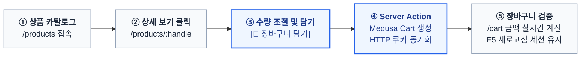
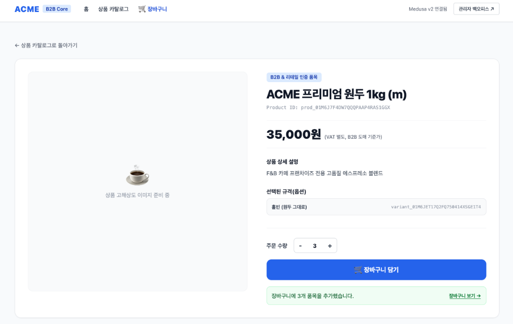
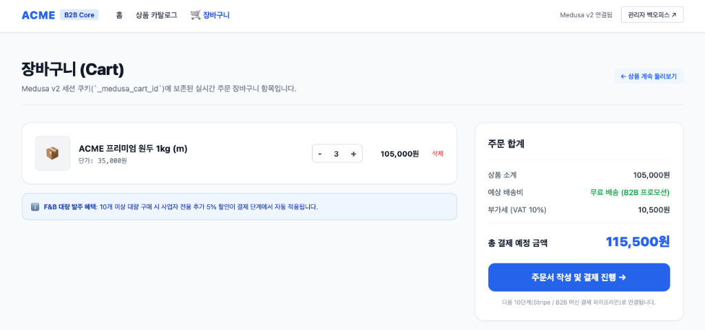

# 09. 카탈로그 탐색 및 장바구니(Cart) 상태 관리 파이프라인

## 🎯 학습 목표 (Goal)
- Medusa Store API를 활용하여 장바구니(`Cart`)의 수명 주기를 제어합니다.
- Next.js의 쿠키(Cookie) 시스템과 Server Actions를 통해 사용자 브라우저와 백엔드 간 장바구니 세션을 안전하게 동기화합니다.
- 브라우저 UI에서 상품 상세 진입, 수량 조절, 장바구니 담기, 쿠키 세션 보존, 실시간 합계 금액 재계산 및 삭제 인터랙션을 직접 테스트하고 검증합니다.

---

## 💡 핵심 개념 (Core Concepts)

### 1. Medusa의 장바구니(Cart) 수명 주기
1. **Cart 생성 (`POST /store/carts`)**:
   - 게스트 또는 로그인 사용자 모두 고유 `cart_id`(`cart_...`)를 발급받으며, 여기에 선택한 통화(Region), 세금 정책, 배송 국가가 바인딩됩니다.
2. **Line Item 조작 (`POST /store/carts/{id}/line-items`)**:
   - 특정 상품의 Variant ID와 수량을 장바구니에 추가/수정/삭제합니다.
3. **쿠키 기반 세션 지속성 (`_medusa_cart_id`)**:
   - 발급받은 `cart_id`를 보안 HTTP 전용 쿠키(`httpOnly: true`)에 보관하여 새로고침이나 재방문 시에도 장바구니 항목이 휘발되지 않고 유지됩니다.

> [!NOTE] **Medusa v2의 장바구니-리전(Region) 필수 종속성과 'No regions found' 해결 원리**
> Medusa v2에서는 장바구니(`Cart`)가 생성될 때 통화 코드(KRW, USD 등), 세율, 국가 정책이 반드시 **리전(Region)**과 결합되어야 합니다.
> - 백엔드에 리전이 0개 등록되어 있으면 백엔드 코어 워크플로우(`createCartWorkflow`)가 즉시 `No regions found` 400 에러를 반환합니다.
> - 따라서 백엔드에 기본 리전(예: `대한민국 (KRW)`)이 등록되어 있어야 하며, Server Action에서는 `sdk.store.region.list()`를 통해 활성화된 리전 ID(`reg_...`)를 조회하여 `cart.create({ region_id: targetRegionId })`로 안전하게 전달해야 합니다.

---

## 🛠️ 실습 코드 (Hands-on)

### 1. 장바구니 Server Actions 구현 (`src/actions/cart.ts`)

Next.js 14 Server Actions를 통해 클라이언트 번들에 API 시크릿을 노출하지 않고 안전하게 백엔드 카트를 조작합니다:

```typescript
// src/actions/cart.ts
"use server"

import { cookies } from "next/headers"
import { revalidatePath, revalidateTag } from "next/cache"
import { sdk } from "@/lib/medusa"

const CART_COOKIE_NAME = "_medusa_cart_id"

export interface CartItem {
  id: string
  title: string
  variant_id: string
  quantity: number
  unit_price: number
  thumbnail?: string | null
}

export interface StoreCart {
  id: string
  items: CartItem[]
  total: number
  subtotal: number
  currency_code: string
}

/**
 * 활성 장바구니를 가져오거나 없으면 새로 생성합니다.
 */
export async function getOrCreateCart(regionId?: string): Promise<string> {
  const cookieStore = cookies()
  const existingCartId = cookieStore.get(CART_COOKIE_NAME)?.value

  if (existingCartId) {
    try {
      const { cart } = await sdk.store.cart.retrieve(existingCartId)
      if (cart && !cart.completed_at) {
        return cart.id
      }
    } catch {
      // 기존 장바구니 만료 시 신규 생성으로 진행
    }
  }

  // regionId가 없을 경우 활성화된 첫 번째 리전 자동 조회 및 연결
  let targetRegionId = regionId
  if (!targetRegionId) {
    try {
      const { regions } = await sdk.store.region.list()
      if (regions && regions.length > 0) {
        targetRegionId = regions[0].id
      }
    } catch {
      // 리전 조회 실패 시 기본 생성 시도
    }
  }

  // 신규 카트 생성
  const { cart } = await sdk.store.cart.create({
    region_id: targetRegionId,
  })

  // 30일간 유지되는 HTTP 쿠키에 cart_id 저장
  cookieStore.set(CART_COOKIE_NAME, cart.id, {
    maxAge: 60 * 60 * 24 * 30,
    httpOnly: true,
    sameSite: "strict",
    secure: process.env.NODE_ENV === "production",
    path: "/",
  })

  return cart.id
}

/**
 * 현재 세션의 장바구니 데이터를 조회합니다.
 */
export async function getCartAction(): Promise<StoreCart | null> {
  const cookieStore = cookies()
  const cartId = cookieStore.get(CART_COOKIE_NAME)?.value

  if (!cartId) return null

  try {
    const { cart } = await sdk.store.cart.retrieve(cartId, {
      fields: "+items.*,+items.variant.*",
    })

    if (!cart) return null

    const rawItems = (cart.items ?? []) as Array<Record<string, unknown>>
    const items: CartItem[] = rawItems.map((item) => ({
      id: String(item.id ?? ""),
      title: String(item.title ?? "상품"),
      variant_id: String(item.variant_id ?? ""),
      quantity: Number(item.quantity ?? 1),
      unit_price: Number(item.unit_price ?? 0),
      thumbnail: typeof item.thumbnail === "string" ? item.thumbnail : null,
    }))

    return {
      id: cart.id,
      items,
      total: Number(cart.total ?? 0),
      subtotal: Number(cart.subtotal ?? 0),
      currency_code: String(cart.currency_code ?? "krw").toUpperCase(),
    }
  } catch {
    return null
  }
}

/**
 * 장바구니에 품목을 추가합니다.
 */
export async function addToCartAction(
  variantId: string,
  quantity: number = 1
): Promise<{ success: boolean; error?: string }> {
  try {
    const cartId = await getOrCreateCart()

    await sdk.store.cart.createLineItem(cartId, {
      variant_id: variantId,
      quantity,
    })

    revalidateTag("cart")
    revalidatePath("/cart")
    return { success: true }
  } catch (err: unknown) {
    const errorMsg = err instanceof Error ? err.message : "장바구니 추가 중 알 수 없는 오류 발생"
    return { success: false, error: errorMsg }
  }
}

/**
 * 장바구니 품목의 수량을 변경하거나 삭제합니다.
 */
export async function updateCartItemAction(
  lineItemId: string,
  quantity: number
): Promise<{ success: boolean; error?: string }> {
  try {
    const cookieStore = cookies()
    const cartId = cookieStore.get(CART_COOKIE_NAME)?.value
    if (!cartId) throw new Error("장바구니 세션을 찾을 수 없습니다.")

    if (quantity <= 0) {
      await sdk.store.cart.deleteLineItem(cartId, lineItemId)
    } else {
      await sdk.store.cart.updateLineItem(cartId, lineItemId, {
        quantity,
      })
    }

    revalidateTag("cart")
    revalidatePath("/cart")
    return { success: true }
  } catch (err: unknown) {
    const errorMsg = err instanceof Error ? err.message : "수량 변경 중 오류 발생"
    return { success: false, error: errorMsg }
  }
}
```

---

### 2. 수량 선택 및 장바구니 담기 클라이언트 버튼 (`src/components/add-to-cart-button.tsx`)

```tsx
// src/components/add-to-cart-button.tsx
"use client"

import { useState } from "react"
import Link from "next/link"
import { addToCartAction } from "@/actions/cart"

interface AddToCartButtonProps {
  variantId?: string
  disabled?: boolean
}

export function AddToCartButton({ variantId, disabled = false }: AddToCartButtonProps) {
  const [quantity, setQuantity] = useState<number>(1)
  const [isPending, setIsPending] = useState<boolean>(false)
  const [feedback, setFeedback] = useState<{ type: "success" | "error"; message: string } | null>(null)

  const handleDecrease = () => {
    if (quantity > 1) {
      setQuantity((prev) => prev - 1)
      setFeedback(null)
    }
  }

  const handleIncrease = () => {
    setQuantity((prev) => prev + 1)
    setFeedback(null)
  }

  const handleAddToCart = async () => {
    if (!variantId) {
      setFeedback({ type: "error", message: "선택 가능한 상품 옵션이 없습니다." })
      return
    }

    setIsPending(true)
    setFeedback(null)

    const result = await addToCartAction(variantId, quantity)

    if (result.success) {
      setFeedback({
        type: "success",
        message: `장바구니에 ${quantity}개 품목을 추가했습니다.`,
      })
    } else {
      setFeedback({
        type: "error",
        message: result.error || "장바구니 담기에 실패했습니다.",
      })
    }

    setIsPending(false)
  }

  return (
    <div className="space-y-4">
      {/* 수량 조절 인터랙션 */}
      <div className="flex items-center gap-x-4">
        <label className="text-sm font-semibold text-gray-700">주문 수량</label>
        <div className="inline-flex items-center border border-gray-300 rounded-lg overflow-hidden bg-white">
          <button
            type="button"
            onClick={handleDecrease}
            disabled={quantity <= 1 || isPending}
            className="px-3 py-1.5 text-gray-600 hover:bg-gray-100 disabled:opacity-40 transition font-bold"
          >
            -
          </button>
          <span className="px-4 py-1.5 text-sm font-bold text-gray-900 min-w-[2.5rem] text-center">
            {quantity}
          </span>
          <button
            type="button"
            onClick={handleIncrease}
            disabled={isPending}
            className="px-3 py-1.5 text-gray-600 hover:bg-gray-100 disabled:opacity-40 transition font-bold"
          >
            +
          </button>
        </div>
      </div>

      {/* 장바구니 담기 버튼 */}
      <button
        type="button"
        disabled={disabled || isPending || !variantId}
        onClick={handleAddToCart}
        className="w-full bg-blue-600 text-white font-bold py-3.5 px-6 rounded-xl shadow-sm hover:bg-blue-700 active:bg-blue-800 disabled:bg-gray-300 disabled:cursor-not-allowed transition-all flex items-center justify-center gap-2"
      >
        {isPending ? "장바구니 담는 중..." : "🛒 장바구니 담기"}
      </button>

      {/* 성공/실패 피드백 배너 */}
      {feedback && (
        <div
          className={`p-3 rounded-lg text-sm flex items-center justify-between ${
            feedback.type === "success"
              ? "bg-green-50 text-green-800 border border-green-200"
              : "bg-red-50 text-red-800 border border-red-200"
          }`}
        >
          <span>{feedback.message}</span>
          {feedback.type === "success" && (
            <Link href="/cart" className="text-xs font-bold text-green-700 underline hover:text-green-900 ml-3">
              장바구니 보기 →
            </Link>
          )}
        </div>
      )}
    </div>
  )
}
```

---

### 3. 상품 상세 페이지 구현 (`src/app/products/[handle]/page.tsx`)

Next.js Server Component를 사용하여 URL 슬러그(`handle`)에 맞는 상품을 조회하고, 상세 사양과 `AddToCartButton`을 배치합니다:

```tsx
// src/app/products/[handle]/page.tsx
import Link from "next/link"
import { notFound } from "next/navigation"
import { sdk } from "@/lib/medusa"
import { AddToCartButton } from "@/components/add-to-cart-button"

interface ProductPageProps {
  params: { handle: string }
}

export default async function ProductDetailPage({ params }: ProductPageProps) {
  // Medusa v2 Store API로 상품 상세 조회
  const { products } = await sdk.store.product.list({
    handle: params.handle,
    fields: "+variants.*",
  }).catch(() => ({ products: [] }))

  const product = products?.[0]
  if (!product) notFound()

  const primaryVariant = product.variants?.[0]

  return (
    <main className="max-w-7xl mx-auto px-4 sm:px-6 lg:px-8 py-12">
      <nav className="mb-6">
        <Link href="/products" className="text-sm font-medium text-gray-500 hover:text-blue-600">
          ← 상품 카탈로그로 돌아가기
        </Link>
      </nav>

      <div className="grid grid-cols-1 lg:grid-cols-2 gap-12 bg-white p-8 rounded-2xl border border-gray-200 shadow-sm">
        <div className="w-full aspect-square rounded-xl bg-gray-50 border flex items-center justify-center">
          <span className="text-6xl">☕</span>
        </div>

        <div className="flex flex-col justify-between">
          <div>
            <span className="bg-blue-100 text-blue-800 text-xs font-semibold px-2.5 py-1 rounded-md">
              B2B & 리테일 인증 품목
            </span>
            <h1 className="text-3xl font-extrabold text-gray-900 mt-3">{product.title}</h1>
            <p className="text-2xl font-black text-gray-900 mt-4">35,000원</p>
            <p className="text-sm text-gray-600 mt-4 leading-relaxed">{product.description}</p>
          </div>

          <div className="mt-8 pt-6 border-t border-gray-100">
            <AddToCartButton variantId={primaryVariant?.id} />
          </div>
        </div>
      </div>
    </main>
  )
}
```

---

### 4. 장바구니 보기 및 수량 관리 화면 (`src/app/cart/page.tsx`)

쿠키 세션에 담긴 품목 목록을 렌더링하고, 수량 증가/감소 및 삭제, 주문 합계 계산을 실시간으로 처리합니다:

```tsx
// src/app/cart/page.tsx
import Link from "next/link"
import { getCartAction } from "@/actions/cart"
import { CartView } from "@/components/cart-view"

export const dynamic = "force-dynamic"

export default async function CartPage() {
  const cart = await getCartAction()

  return (
    <main className="max-w-7xl mx-auto px-4 sm:px-6 lg:px-8 py-12">
      <div className="border-b border-gray-200 pb-5 mb-8 flex justify-between items-center">
        <div>
          <h1 className="text-3xl font-extrabold text-gray-900">장바구니 (Cart)</h1>
          <p className="mt-1 text-sm text-gray-500">
            Medusa v2 세션 쿠키(`_medusa_cart_id`)에 보존된 실시간 주문 장바구니 항목입니다.
          </p>
        </div>
        <Link href="/products" className="text-xs font-semibold text-blue-600 bg-blue-50 px-3 py-1.5 rounded-lg">
          ← 상품 계속 둘러보기
        </Link>
      </div>

      <CartView initialCart={cart} />
    </main>
  )
}
```

---

## 🧪 브라우저 UI 실시간 테스트 및 검증 가이드 (Verification Steps)

구축된 카탈로그 상세 및 장바구니(Cart) 파이프라인을 브라우저에서 단계별로 테스트하고 검증합니다.

<p align="center">
  <picture>
    <source media="(prefers-color-scheme: dark)" srcset="images/09-cart-flow-dark.svg">
    
  </picture>
</p>

<details>
<summary>🔍 <b>Mermaid 원본 소스 코드 보기</b> (클릭하여 펼치기)</summary>



</details>

---

### 1단계: 사전 준비 및 두 서버 구동 확인

1. **Medusa 백엔드 (포트 9000)**:
   ```bash
   cd examples/basic-app
   npm run dev
   ```
   - 브라우저에서 `http://localhost:9000/app`이 정상 응답하는지 확인합니다.

2. **Next.js 스토어프론트 (포트 3000)**:
   ```bash
   cd examples/final-project
   npm run dev
   ```
   - 브라우저에서 `http://localhost:3000/products`로 이동합니다.

---

### 2단계: 상품 상세 페이지 진입 및 옵션/수량 확인

1. 웹 브라우저에서 **`http://localhost:3000/products`**로 접속합니다.
2. 등록된 상품 카드(`ACME 프리미엄 원두 1kg (m)`) 우측 하단의 **`[상세 보기 →]`** 버튼을 클릭합니다.
3. 상품 상세 페이지(**`http://localhost:3000/products/acme-premium-coffee-beans-1kg`**)로 이동합니다:
   - **상품명**: `ACME 프리미엄 원두 1kg (m)`
   - **도매 기준가**: `35,000원 (VAT 별도)`
   - **선택된 규격**: `홀빈 (원두 그대로)` / SKU ID 확인
   - **수량 조절기**: 초기 수량 `1` 확인

---

### 3단계: 수량 변경 및 `[장바구니 담기]` Server Action 실행

1. 수량 조절기에서 **`+`** 버튼을 2회 클릭하여 수량을 **`3`**으로 변경합니다.
2. 파란색 **`[🛒 장바구니 담기]`** 버튼을 클릭합니다:
   - 버튼 텍스트가 즉시 **`장바구니 담는 중...`** 로 변경되며 스피너가 회전합니다 (비동기 Server Action 실행).
   - 처리가 완료되면 버튼 아래에 연두색 안내 배너가 표시됩니다:
     > `장바구니에 3개 품목을 추가했습니다.` `[장바구니 보기 →]`

<p align="center">
  
</p>
<p align="center" style="color: #6b7280; font-size: 0.875rem; margin-top: -8px; margin-bottom: 24px;">
  ▲ 수량(3개) 선택 후 <b>[🛒 장바구니 담기]</b> 클릭 시 Medusa v2 백엔드와 Server Action 통신을 거쳐 성공 피드백 배너가 출력된 화면
</p>

---

### 4단계: 개발자 도구(F12)에서 쿠키(`_medusa_cart_id`) 세션 검증

Next.js Server Action이 브라우저에 쿠키를 정상적으로 세팅했는지 확인합니다:

1. 키보드의 **`F12`** (또는 `Cmd + Option + I`)를 눌러 브라우저 개발자 도구를 엽니다.
2. 상단 탭에서 **`Application`** (Chrome 기준) ➡️ 좌측 사이드바 **`Storage` > `Cookies` > `http://localhost:3000`**을 클릭합니다.
3. 쿠키 목록에서 **`_medusa_cart_id`**가 존재하는지 확인합니다:
   - **Name**: `_medusa_cart_id`
   - **Value**: `cart_01...` (Medusa 백엔드가 발급한 고유 Cart ID)
   - **HttpOnly**: 체크(True) 상태 확인 *(자바스크립트 XSS 공격으로부터 안전하게 보호됨)*

---

### 5단계: 장바구니 화면(`/cart`)에서 수량 변경 및 실시간 합계 검증

1. 상세 페이지 안내 배너의 `[장바구니 보기 →]`를 클릭하거나 상단 네비게이션의 **`[🛒 장바구니]`** (`http://localhost:3000/cart`)로 이동합니다.
2. 장바구니 화면 구성 요소를 점검합니다:
   - **담긴 품목**: `ACME 프리미엄 원두 1kg (m)`
   - **단가**: `35,000원`
   - **현재 수량**: `3`
   - **품목 소계**: `105,000원` (`35,000원 × 3`)
   - **주문 합계 사이드바**:
     - 상품 소계: `105,000원`
     - 예상 배송비: `무료 배송 (B2B 프로모션)`
     - 부가세(10%): `10,500원`
     - **총 결제 예정 금액**: `115,500원`

<p align="center">
  
</p>
<p align="center" style="color: #6b7280; font-size: 0.875rem; margin-top: -8px; margin-bottom: 24px;">
  ▲ Next.js 14 스토어프론트 장바구니(<code>/cart</code>) 실시간 렌더링 화면: 품목 단가, 수량(3개), 소계 및 부가세가 반영된 주문 합계(115,500원)
</p>

3. **수량 변경 인터랙션 테스트**:
   - 수량의 **`+`** 버튼을 눌러 `4`로 올립니다.
   - 즉시 상품 소계가 `140,000원`, 총 결제 예정 금액이 `154,000원`으로 재계산되는지 확인합니다.
4. **품목 삭제 인터랙션 테스트**:
   - 우측의 **`[삭제]`** 버튼을 클릭하면 품목이 목록에서 사라지고, 장바구니가 비었을 때 **"장바구니가 비어 있습니다 (둘러보기 링크)"** 화면으로 부드럽게 전환되는지 확인합니다.

---

### 6단계: 새로고침(F5) 세션 지속성(Persistence) 검증

1. 다시 상품 상세 페이지로 이동하여 상품을 장바구니에 1개 담습니다.
2. 장바구니 페이지(`/cart`)에서 키보드의 **`F5`** (또는 `Cmd + R`)를 눌러 페이지를 강제 새로고침합니다.
3. **검증 결과**:
   - 일반 클라이언트 상태(React state)였다면 새로고침 시 데이터가 모두 날아가지만,
   - HTTP-Only 쿠키(`_medusa_cart_id`)에 저장된 ID를 통해 **새로고침 후에도 장바구니 품목과 수량이 그대로 보존**됨을 확인합니다!

---

## 🏁 마무리 및 다음 단계
장바구니 생성, 품목 추가, 수량 변경, 삭제 및 세션 보존형 Server Actions UI 파이프라인이 완성되었습니다.

다음 단계인 [10-stripe-payment-integration.md](10-stripe-payment-integration.md)에서는 장바구니의 `cart_id`를 기반으로 글로벌 표준 결제 게이트웨이인 **Stripe Payment Element 연동 및 B2B 여신 한도 분기 결제 파이프라인**을 구축합니다.
