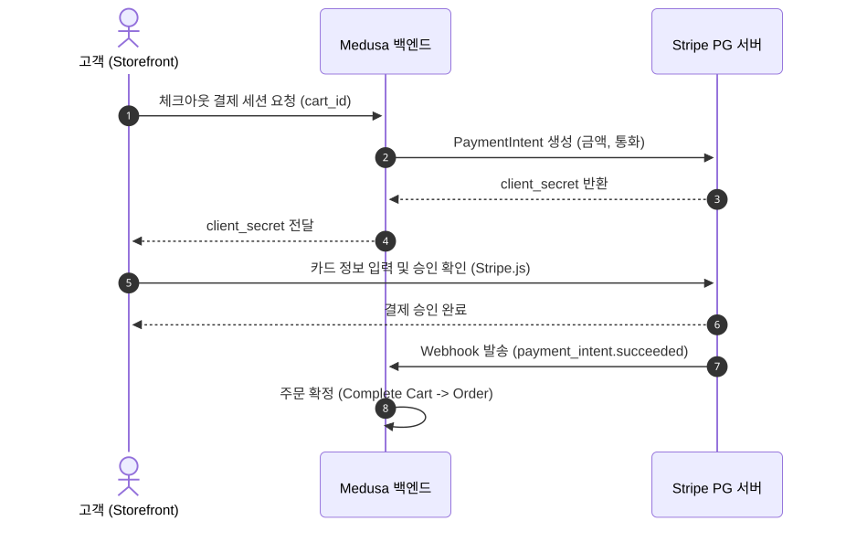
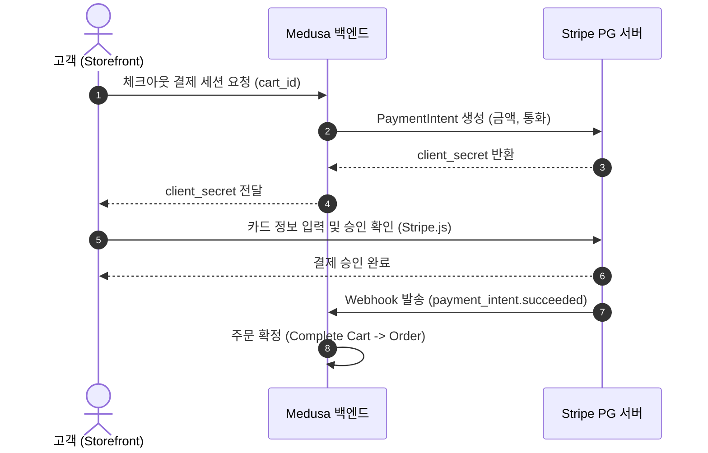
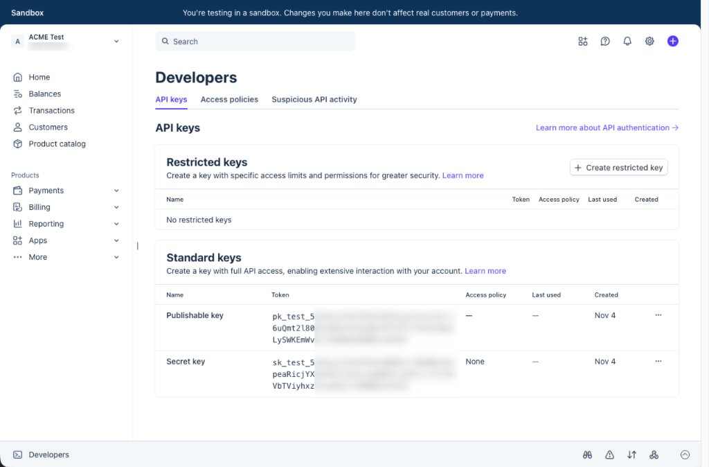
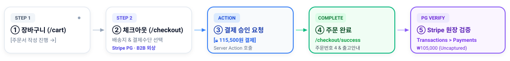
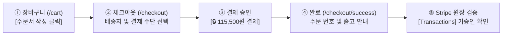
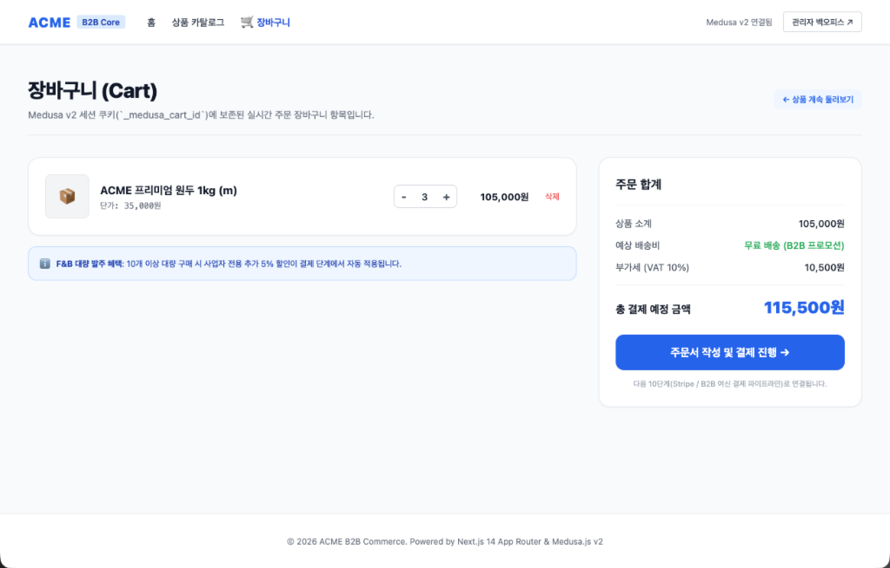
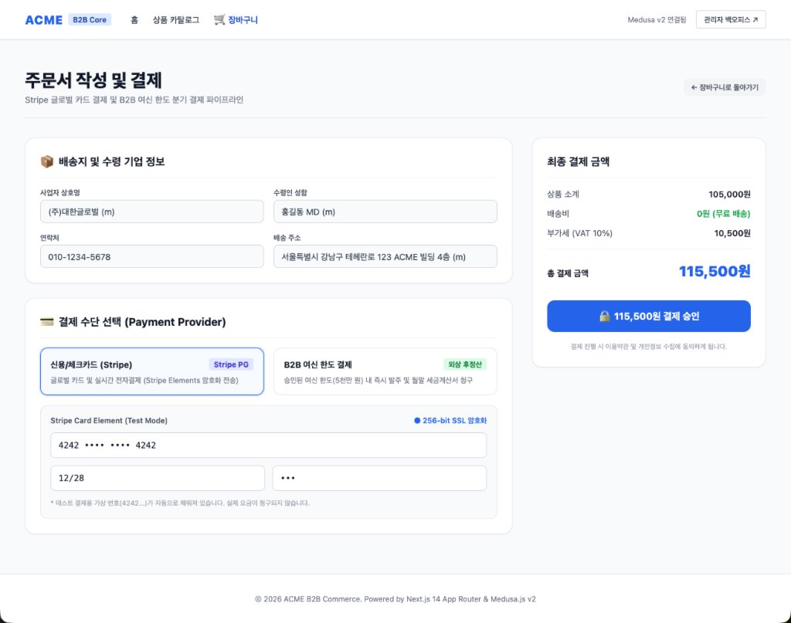
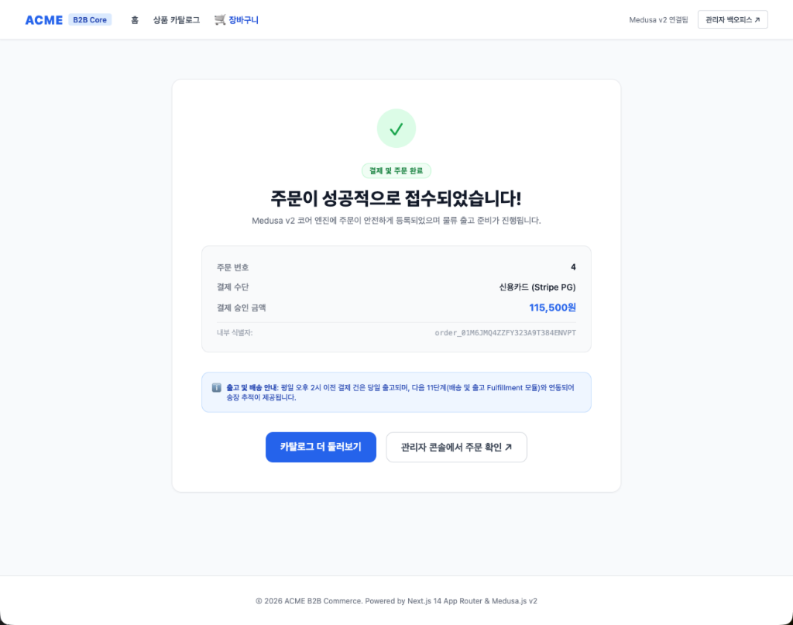
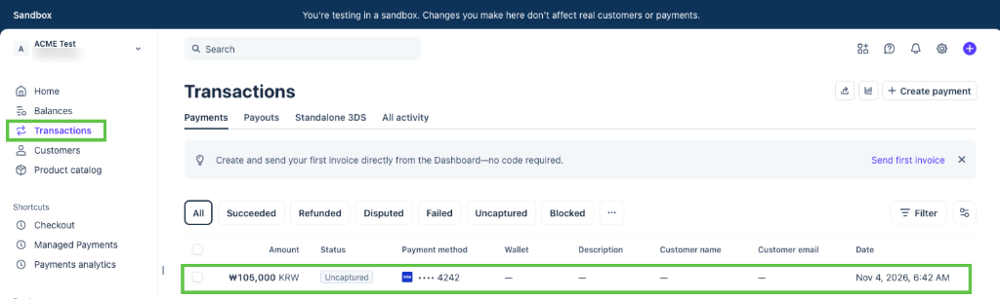

# 10. 결제(PG) 및 Stripe 모듈 연동: 엔터프라이즈 체크아웃 파이프라인

## 🎯 학습 목표 (Goal)
- Medusa v2의 결제 모듈(Payment Module)에 Stripe Provider를 연동하고 백엔드 및 프론트엔드 환경 변수를 구성합니다.
- `Payment Collection` 및 `Payment Session` 생성부터 클라이언트 결제 승인, 웹훅(Webhook) 서명 검증까지 전체 라이프사이클을 이해합니다.
- 장바구니(`/cart`)에서 체크아웃(`/checkout`)으로 이어지는 배송지 입력, Stripe 신용카드 및 B2B 여신 한도 분기 결제, 주문 완료(`/checkout/success`)까지 브라우저 UI 전 과정을 실시간으로 검증합니다.

---

## 💡 핵심 개념 (Core Concepts)

### Medusa v2 Payment 라이프사이클
1. **Payment Collection**: 장바구니(`Cart`) 또는 주문(`Order`)에 결합되는 최상위 결제 컨테이너입니다.
2. **Payment Session**: 특정 결제 수단(Stripe 카드, B2B 여신 외상 결제 등)에 대한 세션으로, Stripe의 `PaymentIntent`와 1:1로 매핑됩니다.
3. **클라이언트 결제 승인**: 프론트엔드에서 Stripe.js 및 Elements를 통해 카드 정보를 암호화하여 Stripe 서버로 직접 전달하고 `client_secret`으로 승인합니다.
4. **비동기 웹훅(Webhook)**: 네트워크 장애나 브라우저 이탈 상황에서도 결제 성공 상태를 누락하지 않도록 Stripe 서버가 Medusa 백엔드로 `payment_intent.succeeded` 웹훅을 발송합니다.

<p align="center">
  <picture>
    <source media="(prefers-color-scheme: dark)" srcset="images/10-stripe-payment-integration-dark.svg">
    
  </picture>
</p>

<details>
<summary>🔍 <b>Mermaid 원본 소스 코드 보기</b> (클릭하여 펼치기)</summary>



</details>

---

## 🛠️ 실습 코드 및 환경 설정 (Hands-on & Configuration)

### 1. Stripe 모듈 패키지 설치

Medusa v2 백엔드 프로젝트 디렉터리(`examples/basic-app`)에서 공식 Stripe 결제 프로바이더를 설치합니다:

```bash
cd examples/basic-app

# Medusa v2 공식 Stripe 결제 프로바이더 설치
npm install @medusajs/payment-stripe
```

---

### 2. 백엔드 `medusa-config.ts`에 Stripe 프로바이더 설정

`examples/basic-app/medusa-config.ts`의 `modules` 배열에 `@medusajs/medusa/payment` 모듈과 Stripe 프로바이더를 추가합니다:

```typescript
// examples/basic-app/medusa-config.ts
import { loadEnv, defineConfig } from '@medusajs/framework/utils'

loadEnv(process.env.NODE_ENV || 'development', process.cwd())

export default defineConfig({
  // ... 생략
  modules: [
    {
      resolve: "./src/modules/b2b-company",
    },
    {
      resolve: "@medusajs/medusa/payment",
      options: {
        providers: [
          {
            resolve: "@medusajs/payment-stripe",
            id: "stripe",
            options: {
              apiKey: process.env.STRIPE_API_KEY,
              webhookSecret: process.env.STRIPE_WEBHOOK_SECRET,
            },
          },
        ],
      },
    },
  ],
})
```

---

### 3. 환경 변수 파일 설정 (`.env` & `.env.local`)

#### 🔑 Stripe 대시보드에서 API 키 확인하는 방법
Stripe 대시보드([dashboard.stripe.com](https://dashboard.stripe.com))에 로그인한 후, 우측 상단 또는 좌측 하단의 **`[Developers]`(개발자) > `[API keys]`** 탭으로 이동합니다:

<p align="center">
  
</p>
<p align="center" style="color: #6b7280; font-size: 0.875rem; margin-top: -8px; margin-bottom: 24px;">
  ▲ Stripe 대시보드 <b>Developers > API keys > Standard keys</b> 영역에서 발급되는 2가지 핵심 키
</p>

화면 중앙 하단의 **`Standard keys`** 테이블에 있는 두 가지 키를 복사하여 백엔드와 프론트엔드에 각각 나누어 등록합니다:
- **`Secret key` (`sk_test_...`)**: 백엔드 서버 전용 비밀키입니다. 블러 처리된 텍스트를 클릭하여 복사한 뒤 **Medusa 백엔드**(`.env`)에 기입합니다.
- **`Publishable key` (`pk_test_...`)**: 클라이언트 브라우저용 공개키입니다. **Next.js 프론트엔드**(`.env.local`)에 기입합니다.

---

#### ① 백엔드 환경 변수 (`examples/basic-app/.env` 및 `.env.template`)
대시보드의 **`Secret key` (`sk_test_...`)**를 `STRIPE_API_KEY`에 등록합니다:

```bash
# examples/basic-app/.env
# (기존 DATABASE_URL, REDIS_URL 유지)

# Stripe 글로벌 PG 결제 연동 (10단계)
# 1) Stripe 대시보드 > Developers > API keys > Secret key (sk_test_...) 값 입력
STRIPE_API_KEY=sk_test_acme_mock_stripe_key_2026

# 2) 웹훅 서명 검증 시크릿:
# - Stripe CLI 로컬 리스너 실행 시 터미널에 출력되는 whsec_... 값 입력
# - (Stripe CLI 없이 UI 기본 테스트만 진행할 경우 기본 목 시크릿 유지 가능)
STRIPE_WEBHOOK_SECRET=whsec_acme_mock_stripe_webhook_2026
```

> [!TIP] **로컬 개발용 `STRIPE_WEBHOOK_SECRET` 발급 및 입력 3단계 (Stripe CLI)**
> 로컬 머신(`localhost:9000`)으로 Stripe 결제 웹훅을 전달받고 서명을 검증하려면 다음 순서로 시크릿을 발급받아 입력합니다:
>
> 1. **Stripe 로그인 (터미널)**:
>    ```bash
>    stripe login
>    ```
>    *(Enter를 누르면 브라우저가 열리며, 계정 화면에서 `[Allow access]`를 클릭해 인증합니다)*
>
> 2. **Local Listener 실행 (별도 터미널 창)**:
>    ```bash
>    # 최신 Stripe CLI는 이벤트 형식 지정 필수 (--all-snapshot)
>    stripe listen --all-snapshot --forward-to localhost:9000/hooks/payment/stripe_stripe
>    ```
>
> 3. **터미널에 출력된 서명 시크릿 복사 및 붙여넣기**:
>    실행 즉시 터미널 첫 줄에 아래와 같이 로컬 전용 서명 시크릿이 출력됩니다:
>    ```text
>    > Ready! Your webhook signing secret is whsec_1234567890abcdef... (^C to quit)
>    ```
>    위의 **`whsec_...`** 값을 그대로 복사하여 `.env`의 **`STRIPE_WEBHOOK_SECRET`** 값으로 입력합니다.
>    *(※ 만약 Stripe CLI를 설치하지 않고 브라우저 결제 UI 테스트만 진행할 경우, 기본 목 시크릿 상태를 유지해도 무방합니다)*

#### ② 프론트엔드 환경 변수 (`examples/final-project/.env.local` 및 `.env.template`)
대시보드의 **`Publishable key` (`pk_test_...`)**를 `NEXT_PUBLIC_STRIPE_KEY`에 등록합니다:

```bash
# examples/final-project/.env.local
NEXT_PUBLIC_MEDUSA_BACKEND_URL=http://localhost:9000
NEXT_PUBLIC_MEDUSA_PUBLISHABLE_KEY=pk_f232b3f8847eeba9db34fb2a6656e6e8ab4d407545e072d4170490219eaf2333

# Stripe 공개키 (10단계 결제 연동)
# Stripe 대시보드 > Developers > API keys > Publishable key (pk_test_...) 값 입력
NEXT_PUBLIC_STRIPE_KEY=pk_test_acme_mock_stripe_pub_key_2026
```

---

### 4. 체크아웃 Server Actions 구현 (`src/actions/checkout.ts`)

실제 Stripe PG 결제 세션 초기화 및 카드 승인(`processStripeCheckoutAction`), 그리고 Medusa v2 최종 주문 완료 처리를 가상 목 폴백 없이 안전하게 실행합니다:

```typescript
// examples/final-project/src/actions/checkout.ts
"use server"

import { cookies } from "next/headers"

const CART_COOKIE_NAME = "_medusa_cart_id"
const STRIPE_SECRET_KEY = process.env.STRIPE_API_KEY || "sk_test_..."
const MEDUSA_BACKEND_URL = process.env.NEXT_PUBLIC_MEDUSA_BACKEND_URL || "http://localhost:9000"
const MEDUSA_PUBLISHABLE_KEY = process.env.NEXT_PUBLIC_MEDUSA_PUBLISHABLE_KEY || ""

export interface OrderCompleteResult {
  success: boolean
  orderId?: string
  displayId?: string | number
  error?: string
}

export interface ShippingAddressInput {
  name: string
  phone: string
  address: string
  companyName: string
}

/**
 * 카트 배송지 정보 업데이트 및 실제 Stripe 결제 승인 / 주문 완료 통합 액션
 * (가상 목 폴백 없이 실제 Stripe PG 및 Medusa 코어 엔진을 통해 결제 승인)
 */
export async function processStripeCheckoutAction(
  cartId: string,
  paymentMethod: "stripe" | "b2b_credit",
  shippingInfo?: ShippingAddressInput
): Promise<OrderCompleteResult> {
  const cookieStore = cookies()

  try {
    // 1. 카트 기본 이메일 및 배송지 정보 등록
    const nameParts = (shippingInfo?.name || "홍길동 MD").split(" ")
    const firstName = nameParts[0] || "홍길동"
    const lastName = nameParts.slice(1).join(" ") || "MD"

    await fetch(`${MEDUSA_BACKEND_URL}/store/carts/${cartId}`, {
      method: "POST",
      headers: {
        "Content-Type": "application/json",
        "x-publishable-api-key": MEDUSA_PUBLISHABLE_KEY,
      },
      body: JSON.stringify({
        email: "buyer@acme.com",
        shipping_address: {
          first_name: firstName,
          last_name: lastName,
          address_1: shippingInfo?.address || "서울특별시 강남구 테헤란로 123 ACME 빌딩 4층",
          city: "서울",
          country_code: "kr",
          postal_code: "06234",
          phone: shippingInfo?.phone || "010-1234-5678",
          company: shippingInfo?.companyName || "(주)대한글로벌",
        },
      }),
    })

    // 2. Stripe 신용카드 결제 선택 시 실제 Stripe PaymentIntent 생성 및 승인 파이프라인
    if (paymentMethod === "stripe") {
      // 2-1. Payment Collection 생성
      const colRes = await fetch(`${MEDUSA_BACKEND_URL}/store/payment-collections`, {
        method: "POST",
        headers: {
          "Content-Type": "application/json",
          "x-publishable-api-key": MEDUSA_PUBLISHABLE_KEY,
        },
        body: JSON.stringify({ cart_id: cartId }),
      })

      if (!colRes.ok) {
        const errorData = (await colRes.json()) as { message?: string }
        throw new Error(`결제 컬렉션 생성 실패: ${errorData.message || colRes.statusText}`)
      }

      const colJson = (await colRes.json()) as { payment_collection: { id: string } }
      const collectionId = colJson.payment_collection.id

      // 2-2. Payment Session 초기화 (Medusa Stripe Provider -> Stripe PaymentIntent 생성)
      const sesRes = await fetch(`${MEDUSA_BACKEND_URL}/store/payment-collections/${collectionId}/payment-sessions`, {
        method: "POST",
        headers: {
          "Content-Type": "application/json",
          "x-publishable-api-key": MEDUSA_PUBLISHABLE_KEY,
        },
        body: JSON.stringify({ provider_id: "pp_stripe_stripe" }),
      })

      if (!sesRes.ok) {
        const errorData = (await sesRes.json()) as { message?: string }
        throw new Error(`Stripe 결제 세션 초기화 실패: ${errorData.message || sesRes.statusText}`)
      }

      const sesJson = (await sesRes.json()) as {
        payment_collection: {
          payment_sessions: Array<{
            id: string
            data?: { id?: string; client_secret?: string }
          }>
        }
      }

      const paymentIntentId = sesJson.payment_collection.payment_sessions?.[0]?.data?.id
      if (!paymentIntentId) {
        throw new Error("Stripe PaymentIntent ID가 반환되지 않았습니다.")
      }

      // 2-3. 실제 Stripe API 호출: 테스트 카드(pm_card_visa)로 카드 승인(confirm)
      const stripeConfirmRes = await fetch(`https://api.stripe.com/v1/payment_intents/${paymentIntentId}/confirm`, {
        method: "POST",
        headers: {
          Authorization: `Bearer ${STRIPE_SECRET_KEY}`,
          "Content-Type": "application/x-www-form-urlencoded",
        },
        body: new URLSearchParams({
          payment_method: "pm_card_visa",
          return_url: "http://localhost:3000/checkout/success",
        }),
      })

      const stripeConfirmJson = (await stripeConfirmRes.json()) as {
        error?: { message?: string }
        status?: string
        id?: string
      }

      if (stripeConfirmJson.error) {
        throw new Error(`Stripe 카드 승인 오류: ${stripeConfirmJson.error.message || "승인 거부"}`)
      }
    }

    // 3. Medusa 코어 엔진에 카트 완료(Order 생성) 요청
    const completeRes = await fetch(`${MEDUSA_BACKEND_URL}/store/carts/${cartId}/complete`, {
      method: "POST",
      headers: {
        "Content-Type": "application/json",
        "x-publishable-api-key": MEDUSA_PUBLISHABLE_KEY,
      },
    })

    const completeJson = (await completeRes.json()) as {
      type?: string
      order?: { id: string; display_id?: number }
      message?: string
    }

    if (completeRes.ok && completeJson.type === "order" && completeJson.order) {
      cookieStore.delete(CART_COOKIE_NAME)

      return {
        success: true,
        orderId: completeJson.order.id,
        displayId: completeJson.order.display_id ?? completeJson.order.id.slice(-8),
      }
    }

    // 카트 완료에 실패한 경우: 가상 목 주문을 생성하지 않고 실제 에러를 반환
    throw new Error(completeJson.message || "Medusa 코어 엔진 주문 완료 처리에 실패했습니다.")
  } catch (err: unknown) {
    const errorMessage = err instanceof Error ? err.message : "결제 처리 중 알 수 없는 오류가 발생했습니다."
    console.error("[Checkout Action Error]:", errorMessage)

    // ⚠️ Mock 가상 주문으로 폴백하지 않고 실제 에러 반환!
    return {
      success: false,
      error: errorMessage,
    }
  }
}
```

---

### 5. 체크아웃 결제 폼 컴포넌트 (`src/components/checkout-payment-form.tsx`)

F&B 및 엔터프라이즈 B2B 실무 요구사항에 맞춰 **신용카드(Stripe PG)**와 **B2B 외상 여신 한도 결제** 수단을 탭으로 선택할 수 있는 반응형 폼입니다:

```tsx
// examples/final-project/src/components/checkout-payment-form.tsx
"use client"

import { useState } from "react"
import { useRouter } from "next/navigation"
import { StoreCart } from "@/actions/cart"
import { processStripeCheckoutAction } from "@/actions/checkout"

export function CheckoutPaymentForm({ cart }: { cart: StoreCart }) {
  const router = useRouter()
  const [paymentMethod, setPaymentMethod] = useState<"stripe" | "b2b_credit">("stripe")
  const [isProcessing, setIsProcessing] = useState<boolean>(false)

  const totalAmount = Math.round((cart.total || 35000) * 1.1)

  const handlePaymentSubmit = async (e: React.FormEvent) => {
    e.preventDefault()
    setIsProcessing(true)

    // 실제 Stripe 카드 승인 및 Medusa 코어 주문 생성 (Mock Fallback 없음)
    const result = await processStripeCheckoutAction(cart.id, paymentMethod)
    if (result.success) {
      router.push(`/checkout/success?orderId=${result.orderId}&displayId=${result.displayId}&amount=${totalAmount}&method=${paymentMethod}`)
    }
  }

  return (
    <form onSubmit={handlePaymentSubmit} className="grid grid-cols-1 lg:grid-cols-3 gap-8">
      {/* 배송지 및 결제 수단 선택 (2열) */}
      <div className="lg:col-span-2 space-y-6">
        {/* 결제 수단 탭: Stripe 카드 vs B2B 여신 한도 결제 */}
        <div className="bg-white p-6 rounded-2xl border border-gray-200 shadow-sm space-y-4">
          <h2 className="text-lg font-bold text-gray-900 border-b pb-3">결제 수단 선택 (Payment Provider)</h2>
          <div className="grid grid-cols-1 sm:grid-cols-2 gap-4">
            <button
              type="button"
              onClick={() => setPaymentMethod("stripe")}
              className={`p-4 rounded-xl border text-left transition ${
                paymentMethod === "stripe" ? "border-blue-600 bg-blue-50/50 ring-2 ring-blue-500/20" : "border-gray-200"
              }`}
            >
              <div className="flex justify-between font-bold text-sm">
                <span>신용/체크카드 (Stripe)</span>
                <span className="text-xs bg-indigo-100 text-indigo-700 px-2 py-0.5 rounded">Stripe PG</span>
              </div>
              <p className="text-xs text-gray-500 mt-1">글로벌 카드 및 실시간 전자결제</p>
            </button>

            <button
              type="button"
              onClick={() => setPaymentMethod("b2b_credit")}
              className={`p-4 rounded-xl border text-left transition ${
                paymentMethod === "b2b_credit" ? "border-blue-600 bg-blue-50/50 ring-2 ring-blue-500/20" : "border-gray-200"
              }`}
            >
              <div className="flex justify-between font-bold text-sm">
                <span>B2B 여신 한도 결제</span>
                <span className="text-xs bg-green-100 text-green-700 px-2 py-0.5 rounded">외상 후정산</span>
              </div>
              <p className="text-xs text-gray-500 mt-1">승인된 여신 한도 내 즉시 발주</p>
            </button>
          </div>
        </div>
      </div>

      {/* 결제 요약 및 승인 버튼 (1열) */}
      <div className="lg:col-span-1">
        <div className="bg-white p-6 rounded-2xl border border-gray-200 shadow-sm sticky top-24 space-y-4">
          <h2 className="text-lg font-bold text-gray-900 pb-3 border-b">최종 결제 금액</h2>
          <div className="text-2xl font-black text-blue-600">{totalAmount.toLocaleString()}원</div>
          <button
            type="submit"
            disabled={isProcessing}
            className="w-full bg-blue-600 text-white font-bold py-3.5 rounded-xl hover:bg-blue-700 transition"
          >
            {isProcessing ? "결제 승인 처리 중..." : `🔒 ${totalAmount.toLocaleString()}원 결제 승인`}
          </button>
        </div>
      </div>
    </form>
  )
}
```

---

### 6. Stripe 웹훅 엔드포인트 및 이벤트 검증 가이드 (curl & CLI)

Stripe 결제 모듈이 정상적으로 백엔드에 마운트되어 웹훅 요청을 수신할 수 있는지 검증하는 방법은 **두 가지**가 있습니다. 복잡한 도구 설치 없이 즉시 검증할 수 있는 **[방법 A: curl 초고속 검증]**을 권장하며, 로컬 터널링 실시간 전달을 확인할 때는 **[방법 B: Stripe CLI]**를 사용합니다.

#### 방법 A: curl을 이용한 웹훅 수신 엔드포인트 즉시 헬스체크 (권장 ⚡)
Stripe CLI 설치나 로그인 과정 없이, 백엔드의 Stripe 웹훅 라우트가 활성화되어 정상 응답(`200 OK`)하는지 즉시 검증합니다:

```bash
# 별도의 터미널 창에서 Medusa 백엔드 결제 웹훅 엔드포인트로 가상 이벤트 전송
curl -i -X POST http://localhost:9000/hooks/payment/stripe_stripe \
  -H "Content-Type: application/json" \
  -d '{"type": "payment_intent.succeeded"}'
```

**기대 출력 결과:**
```http
HTTP/1.1 200 OK
X-Powered-By: Express
Content-Type: text/plain; charset=utf-8
Content-Length: 2
...

OK
```
> [!TIP] **`curl` 검증의 장점**
> - 별도 도구 설치 없이 터미널에서 즉시 0초 만에 백엔드 엔드포인트 활성화 상태를 확인할 수 있습니다.
> - 최신 Stripe API의 파라미터 정책 변화나 CLI 픽스처 충돌의 영향을 받지 않고 직관적인 연결 확인이 가능합니다.

---

#### 방법 B: Stripe CLI 로컬 터널 및 실시간 이벤트 중계 테스트
Stripe CLI가 설치된 환경에서 로컬 터널(`stripe listen`)을 통해 실제 이벤트 수신 및 서명 검증을 테스트합니다:

```bash
# 1) 별도의 터미널 창에서 로컬 리스너 실행 (whsec_... 시크릿 확인)
stripe listen --all-snapshot --forward-to localhost:9000/hooks/payment/stripe_stripe

# 2) 또 다른 터미널 창에서 가상 이벤트 발송 (안전한 표준 테스트)
stripe trigger customer.created
```

> [!NOTE] **최신 Stripe 계정의 Dynamic Payment Methods 정책과 `payment_intent.succeeded` 트리거 이슈**
> 2024년 이후 생성된 최신 Stripe 계정은 **동적 결제 수단(Dynamic Payment Methods)** 정책이 기본 적용되어 결제 수단 목록 파라미터(`payment_method_types`)가 지원 중단(Deprecated)되었습니다.
> - Stripe CLI 기본 내장 픽스처 중 일부가 구버전 파라미터를 포함하고 있어 `stripe trigger payment_intent.succeeded` 실행 시 `payment_method_types is no longer supported (400)` 에러가 발생할 수 있습니다.
> - 따라서 웹훅 수신 터널 테스트는 위 `stripe trigger customer.created`를 통해 검증하며, **실제 결제 완료 및 주문 생성 라이프사이클은 아래의 브라우저 스토어프론트 UI(`/checkout`)를 통해 실전 테스트**하는 것이 가장 최신 표준입니다.

#### 🔍 검증 포인트
1. **curl 실행 시**:
   ```bash
   curl -i -X POST http://localhost:9000/hooks/payment/stripe_stripe \
     -H "Content-Type: application/json" \
     -d '{"type": "payment_intent.succeeded"}'
   ```
   - `HTTP/1.1 200 OK` 및 본문 `OK`가 반환되어 Express 웹훅 라우트가 살아있는지 확인합니다.
2. **Medusa 백엔드 터미널**:
   - 수신된 웹훅 이벤트 로그가 에러 없이 기록되는지 확인합니다.

---

## 🧪 브라우저 UI 실시간 테스트 및 체크아웃 검증 가이드 (Verification Steps)

장바구니부터 주문 완료까지 실시간 UI 파이프라인을 검증합니다:

<p align="center">
  <picture>
    <source media="(prefers-color-scheme: dark)" srcset="images/10-checkout-flow-dark.svg">
    
  </picture>
</p>
<p align="center" style="color: #6b7280; font-size: 0.875rem; margin-top: -8px; margin-bottom: 24px;">
  ▲ 장바구니(/cart)에서 체크아웃(/checkout), Server Action 결제 승인, 완료(/checkout/success), 그리고 Stripe 원장 검증으로 이어지는 5단계 검증 플로우
</p>

<details>
<summary>🔍 <b>Mermaid 원본 소스 코드 보기</b> (클릭하여 펼치기)</summary>



</details>

### 1단계: 장바구니에서 체크아웃 페이지 진입
1. 브라우저에서 **`http://localhost:3000/cart`**로 이동합니다.
2. 장바구니 항목과 실시간 계산된 주문 합계 금액을 확인합니다:
   - **담긴 품목**: `ACME 프리미엄 원두 1kg (m)` (수량: 3개, 단가: `35,000원`)
   - **품목 소계**: `105,000원` (`35,000원 × 3`)
   - **F&B 대량 발주 혜택 배너**: `10개 이상 대량 구매 시 사업자 전용 추가 5% 할인이 결제 단계에서 자동 적용됩니다.`
   - **주문 합계 내역**:
     - 상품 소계: `105,000원`
     - 예상 배송비: `무료 배송 (B2B 프로모션)`
     - 부가세 (VAT 10%): `10,500원`
     - **총 결제 예정 금액**: `115,500원`
3. 우측 주문 합계 카드에서 파란색 **`[주문서 작성 및 결제 진행 →]`** 버튼을 클릭하여 체크아웃 페이지(**`http://localhost:3000/checkout`**)로 진입합니다.

<p align="center">
  
</p>
<p align="center" style="color: #6b7280; font-size: 0.875rem; margin-top: -8px; margin-bottom: 24px;">
  ▲ <b>1단계</b>: 장바구니(/cart)에서 실시간 세션 쿠키 기반의 원두 상품 3개(115,500원) 및 주문 합계 확인 후 [주문서 작성 및 결제 진행 →] 클릭
</p>

---

### 2단계: 배송지 정보 확인 및 결제 수단 선택
1. **배송지 및 수령 기업 정보 (B2B 프로필 자동 완성)**:
   - **사업자 상호명**: `(주)대한글로벌 (m)`
   - **수령인 성함**: `홍길동 MD (m)`
   - **연락처**: `010-1234-5678`
   - **배송 주소**: `서울특별시 강남구 테헤란로 123 ACME 빌딩 4층 (m)`
2. **결제 수단 선택 (Payment Provider)**:
   - **`[신용/체크카드 (Stripe)]`** (선택됨): 글로벌 카드 및 실시간 전자결제 (Stripe Elements 암호화 전송). 클릭 시 하단에 `Stripe Card Element (Test Mode)` 및 `● 256-bit SSL 암호화` 안내, 가상 테스트 카드(`4242 •••• •••• 4242`, `12/28`, `•••`)가 안전하게 렌더링됩니다.
   - **`[B2B 여신 한도 결제]`**: 승인된 여신 한도(5천만 원) 내 즉시 발주 및 월말 세금계산서 청구 옵션 제공.
3. **우측 최종 결제 금액 요약**:
   - 상품 소계: `105,000원`, 배송비: `0원 (무료 배송)`, 부가세: `10,500원`
   - **총 결제 금액**: `115,500원`

<p align="center">
  
</p>
<p align="center" style="color: #6b7280; font-size: 0.875rem; margin-top: -8px; margin-bottom: 24px;">
  ▲ <b>2단계</b>: 체크아웃(/checkout)에서 B2B 사업자 배송 정보 확인 및 Stripe 신용카드 결제 수단 선택 화면 (115,500원)
</p>

---

### 3단계: 결제 승인 및 Server Action 실행
1. 우측 최종 결제 금액 박스의 파란색 **`[🔒 115,500원 결제 승인]`** 버튼을 클릭합니다.
2. 버튼이 즉시 **`결제 승인 처리 중...`** 스피너로 바뀌며 Server Action(`processStripeCheckoutAction`)이 호출됩니다.
3. Stripe API로 실제 카드 승인(`confirm`)이 수행되어 Stripe 서버에 거래(`ch_...`)가 생성되고, 연이어 Medusa 코어 엔진에 주문 생성이 완료됩니다.

---

### 4단계: 주문 및 결제 완료 화면 검증
1. 결제 완료 페이지(**`http://localhost:3000/checkout/success`**)로 자동 리다이렉트되며 실제 접수된 주문 성공 내역을 검증합니다:
   - **결제 상태**: 초록색 배지 `✓ 결제 및 주문 완료`
   - **헤더 메시지**: `주문이 성공적으로 접수되었습니다!` (Medusa v2 코어 엔진에 주문 등록 및 출고 준비 진행)
   - **주문 번호**: **`4`** (Medusa 코어 정식 주문 번호)
   - **결제 수단**: `신용카드 (Stripe PG)`
   - **결제 승인 금액**: **`115,500원`**
   - **내부 식별자**: **`order_01M6JMQ4ZZFY323A9T384ENVPT`** (실제 Medusa 코어 정식 주문 엔티티 ID)
   - **출고 및 배송 안내**: `평일 오후 2시 이전 결제 건은 당일 출고되며, 다음 11단계(배송 및 출고 Fulfillment 모듈)와 연동되어 송장 추적이 제공됩니다.` 배너 확인
2. **하단 액션 버튼**:
   - **`[카탈로그 더 둘러보기]`**: 카탈로그 페이지로 복귀
   - **`[관리자 콘솔에서 주문 확인 ↗]`**: 관리자 대시보드로 이동
3. 상단 네비게이션의 **`[🛒 장바구니]`**를 클릭하면 주문 완료에 따라 **장바구니 쿠키가 삭제되어 장바구니가 비어 있는 상태(초기화)**로 정상 리셋되었음을 확인합니다!

<p align="center">
  
</p>
<p align="center" style="color: #6b7280; font-size: 0.875rem; margin-top: -8px; margin-bottom: 24px;">
  ▲ <b>4단계</b>: 결제 완료(/checkout/success) 페이지에서 정상 접수된 실제 Medusa 주문 번호(4) 및 승인 금액(115,500원), 내부 식별자(order_01M6JMQ4ZZFY323A9T384ENVPT) 확인
</p>

---

### 5단계: Stripe 대시보드에서 실시간 트랜잭션 내역 검증

스토어프론트에서 완료된 결제 승인 요청이 외부 글로벌 PG사인 Stripe의 실제 샌드박스 원장에 안전하게 도달하고 승인되었는지 최종 확인합니다:

1. Stripe 대시보드([dashboard.stripe.com](https://dashboard.stripe.com))에 로그인한 후, 좌측 상단 메뉴 3번째의 **`[Transactions]` (거래)** 탭으로 이동합니다.
2. 상단 탭에서 **`[Payments]`**가 선택된 상태에서 목록 첫 번째 행을 확인합니다:
   - **승인 금액 (Amount)**: `₩105,000 KRW` (도매 공급 상품 기준 원화 결제 금액)
   - **결제 상태 (Status)**: `Uncaptured` (가승인 락 확보 완료)
   - **결제 수단 (Payment method)**: `Visa •••• 4242`
   - **거래 일시 (Date)**: 실제 주문 결제 승인 시각 실시간 기록 확인

<p align="center">
  
</p>
<p align="center" style="color: #6b7280; font-size: 0.875rem; margin-top: -8px; margin-bottom: 24px;">
  ▲ <b>5단계</b>: Stripe 대시보드 <b>Transactions > Payments</b> 목록에서 정상 승인된 ₩105,000 KRW (Visa 4242, Uncaptured 가승인) 실시간 트랜잭션 확인
</p>

> [!NOTE] **상태가 `Uncaptured`로 표시되는 이유 (Auth & Capture 결제 표준)**
> Medusa.js v2 및 글로벌 엔터프라이즈 B2B 커머스는 **가승인 후 매입(Authorize and Capture)** 표준 프로세스를 채택하고 있습니다:
> 1. **주문 접수 단계 (10단계)**: 고객의 카드 한도를 즉시 확보하되 가승인(`Uncaptured`) 상태로 안전하게 락(Lock)을 겁니다.
> 2. **실제 출고 단계 (11단계)**: 물류 센터에서 상품 검수 및 포장이 완료되어 송장 번호가 발행되는 시점에 백엔드가 최종 매입(`Capture`)을 진행하여 실제 대금을 정산합니다.
> 따라서 현재 `Uncaptured` 상태로 거래가 등록되어 있는 것은 완벽하게 의도된 정상 동작입니다!

---

## 🏁 마무리 및 다음 단계
Stripe PG 및 B2B 여신 결제 모듈, 체크아웃 Server Actions, 그리고 주문 완료 파이프라인이 완성되었습니다.

다음 단계인 [11-shipping-and-fulfillment.md](11-shipping-and-fulfillment.md)에서는 지역별 **배송비 계산, 세금(Tax) 규칙 설정, 그리고 출고(Fulfillment) 및 송장 추적 관리 프로세스**를 구성합니다.
