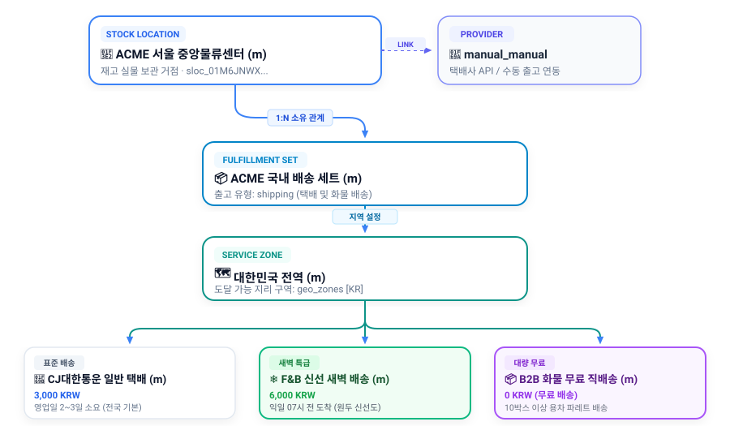
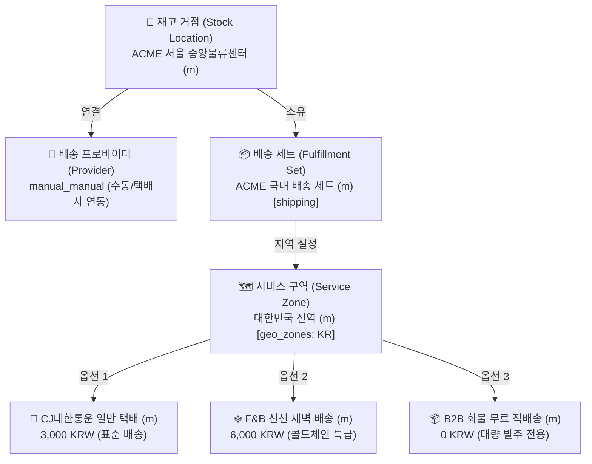
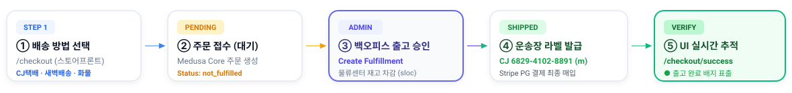
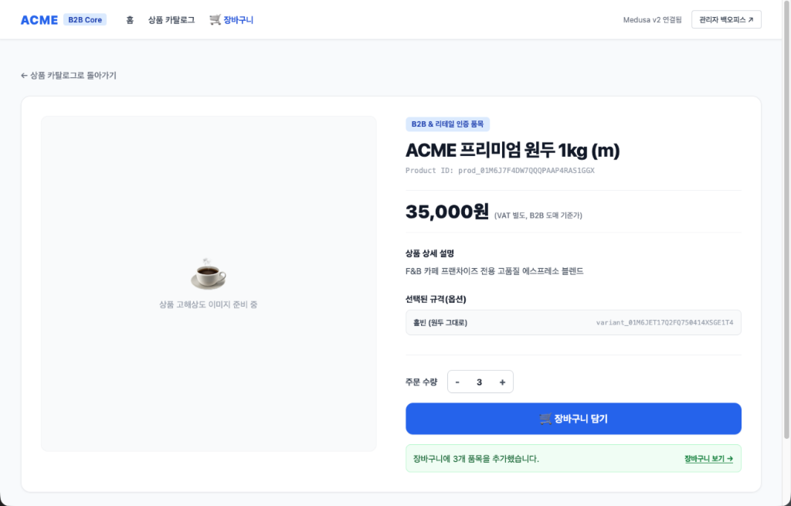
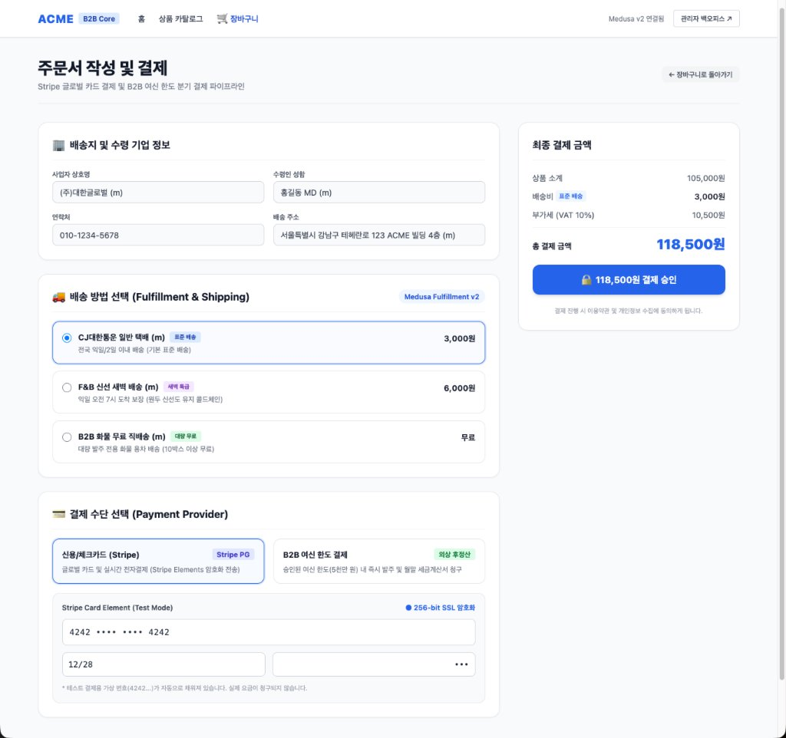
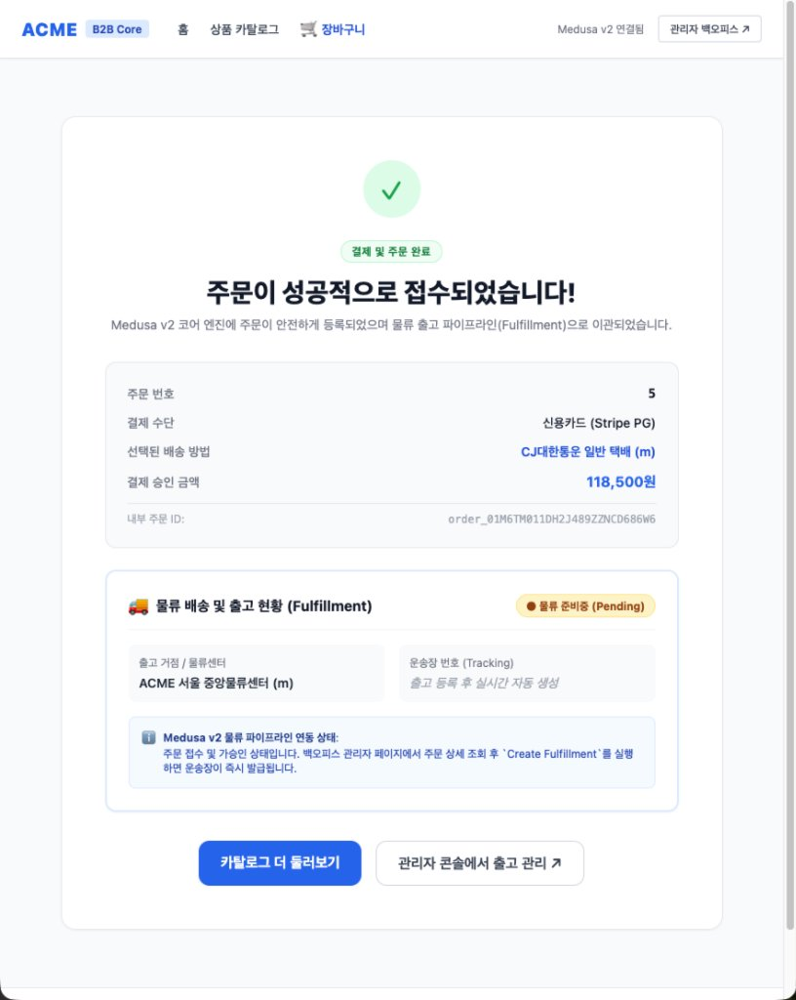
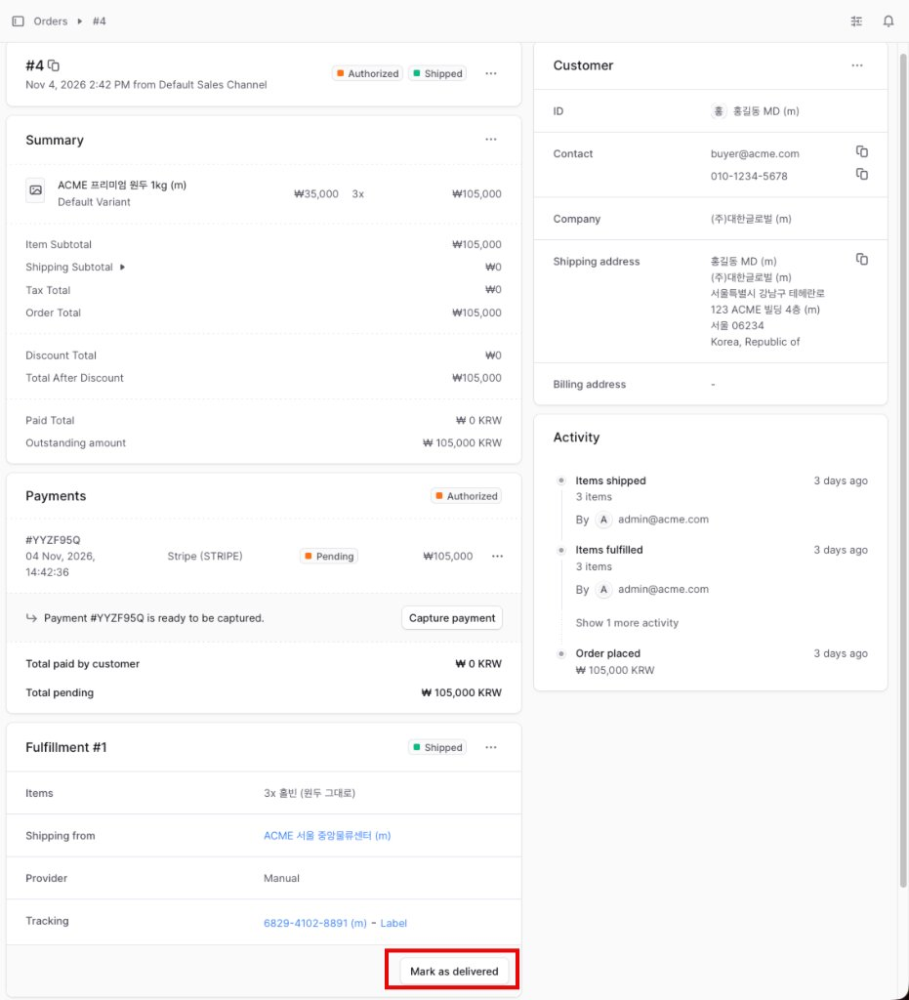
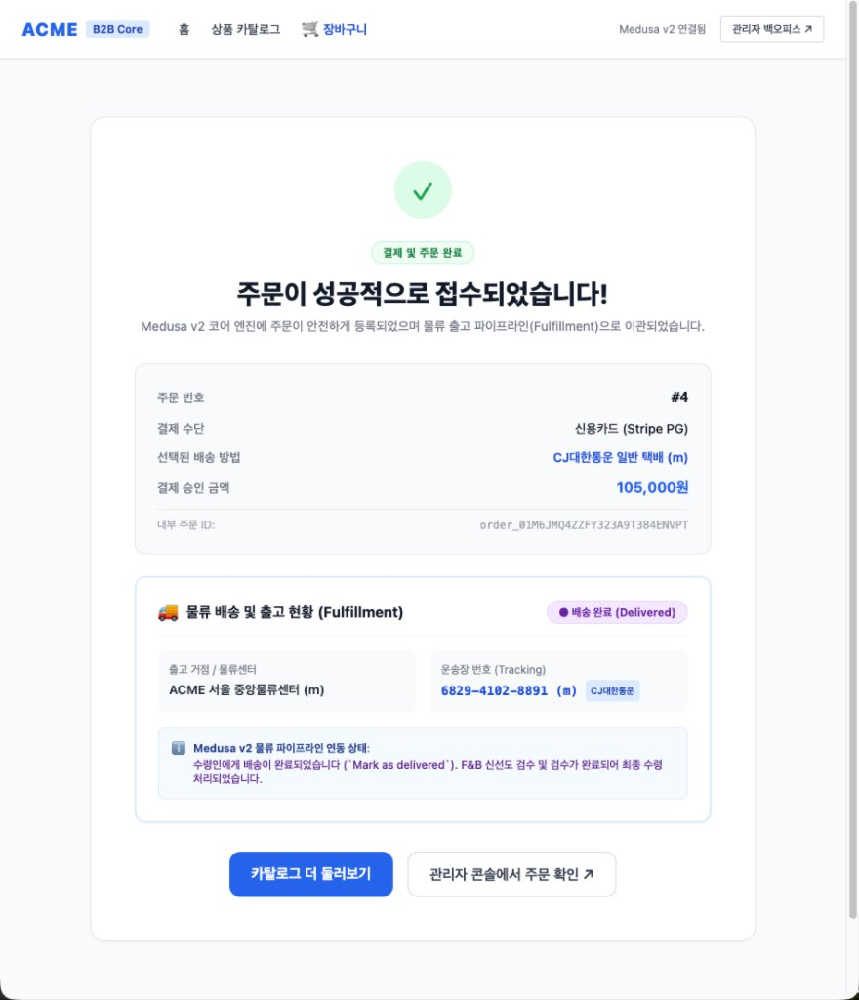

# 11. 배송(Fulfillment) 및 세금(Tax) 파이프라인

## 🎯 학습 목표 (Goal)
- **Medusa v2 Fulfillment 모듈**의 핵심 계층 구조(`StockLocation` ➔ `FulfillmentSet` ➔ `ServiceZone` ➔ `ShippingOption`)를 이해하고 B2B/F&B 맞춤형 물류망을 구축합니다.
- Next.js 14 App Router 스토어프론트에서 **3가지 맞춤형 배송 옵션(일반 택배, F&B 새벽배송, B2B 무료 화물)**을 실시간 선택하고 배송비가 카트에 즉시 반영되는 인터페이스를 구현합니다.
- 이커머스 엔터프라이즈 표준인 **가승인 후 출고 시점 매입(Authorize at Checkout ➔ Capture at Fulfillment)** 라이프사이클을 이해하고, Medusa 관리자 백오피스에서 운송장 번호를 등록하여 프론트엔드 주문 완료 화면에 실시간 배송 상태가 동기화되는 전 과정을 검증합니다.

---

## 💡 핵심 아키텍처 및 이커머스 배송 생명주기 (Core Architecture & Lifecycle)

### 1. Medusa v2 Fulfillment 모듈의 4단계 계층 구조
Medusa v2는 배송 정책을 단순한 고정값으로 다루지 않고, 물리적 물류 거점과 판매 채널, 지리적 배송 구역을 완벽히 격리·연결하는 정교한 계층 구조를 제공합니다.

<p align="center">
  <picture>
    <source media="(prefers-color-scheme: dark)" srcset="images/11-fulfillment-hierarchy-dark.svg">
    
  </picture>
</p>

<details>
<summary>🔍 <b>Mermaid 원본 소스 코드 보기</b> (클릭하여 펼치기)</summary>



</details>

1. **재고 거점 (`Stock Location`)**: 상품 실물이 보관되고 출고되는 물리적 물류센터 창고입니다.
2. **배송 세트 (`Fulfillment Set`)**: 출고 방식(택배 배송 `shipping` 또는 매장 픽업 `pickup`)을 정의합니다.
3. **서비스 구역 (`Service Zone`)**: 배송이 도달 가능한 지리적 영역(국가 코드 `kr`, 우편번호, 도시 등)을 지정합니다.
4. **배송 옵션 (`Shipping Option`)**: 결제 시 고객에게 노출되는 구체적인 배송 서비스 상품 및 가격 정책입니다.

---

### 2. 엔터프라이즈 결제-배송 파이프라인 (Authorize & Capture)

현업 F&B 및 커머스 엔터프라이즈에서는 주문 즉시 카드 대금을 매입하지 않고, 물류센터에서 재고가 정상 출고되어 운송장 번호가 발행될 때 최종 카드 매입(`Capture`)을 실행합니다.

<p align="center">
  <picture>
    <source media="(prefers-color-scheme: dark)" srcset="images/11-fulfillment-pipeline-dark.svg">
    
  </picture>
</p>

1. **① 배송 방법 선택 (`/checkout`)**: 고객이 택배, 콜드체인 새벽배송, 화물 직배송 중 필요한 옵션을 선택합니다.
2. **② 주문 접수 & 가승인 (`Medusa Core`)**: Stripe 결제가 가승인(`Uncaptured`)되며 주문 상태는 출고 대기(`not_fulfilled`)로 등록됩니다.
3. **③ 백오피스 출고 승인 (`Medusa Admin`)**: 물류 담당자가 주문을 확인하고 `[Create Fulfillment]`를 실행하여 재고를 차감합니다.
4. **④ 운송장 라벨 발급 (`Shipment`)**: 택배사 송장 번호(예: `CJ 6829-4102-8891 (m)`)를 입력하면 Stripe 가승인 대금이 자동 매입(`Capture`)됩니다.
5. **⑤ UI 실시간 배송 추적 (`/checkout/success`)**: 고객 주문 완료 페이지에서 출고 완료 배지와 송장 번호가 실시간 표출됩니다.

---

## 🛠️ 백엔드 인프라 구축 (Fulfillment & Shipping Setup)

### 1. 배송 옵션 시드 스크립트 (`src/scripts/seed-shipping.ts`)

Medusa v2에서 배송 옵션을 생성하기 전, 반드시 물류 거점(`Stock Location`)에 `Fulfillment Provider`와 `Sales Channel`이 링크되어 있어야 합니다.

```typescript
// examples/basic-app/src/scripts/seed-shipping.ts
import { ExecArgs } from "@medusajs/framework/types"
import { ContainerRegistrationKeys, Modules } from "@medusajs/framework/utils"

export default async function seedShipping({ container }: ExecArgs) {
  const logger = container.resolve(ContainerRegistrationKeys.LOGGER)
  const query = container.resolve(ContainerRegistrationKeys.QUERY)
  const fulfillmentModule = container.resolve(Modules.FULFILLMENT)
  const stockLocationModule = container.resolve(Modules.STOCK_LOCATION)

  logger.info("📦 ACME B2B 배송(Fulfillment) 및 배송 옵션 인프라 구성 시작...")

  // 1. 기존 배송 옵션 중복 검사
  const existingOptions = await fulfillmentModule.listShippingOptions({
    name: [
      "CJ대한통운 일반 택배 (m)",
      "F&B 신선 새벽 배송 (m)",
      "B2B 화물 무료 직배송 (m)",
    ],
  })

  if (existingOptions.length > 0) {
    logger.info("ℹ️ 이미 배송 옵션 3종이 등록되어 있습니다.")
    return
  }

  // 2. 기본 배송 프로필(Shipping Profile) 조회
  const { data: shippingProfiles } = await query.graph({
    entity: "shipping_profile",
    fields: ["id", "name", "type"],
  })
  const defaultProfile = shippingProfiles[0]

  // 3. 재고 거점(Stock Location) 생성 또는 조회
  const [existingLocs] = await stockLocationModule.listAndCountStockLocations({
    name: "ACME 서울 중앙물류센터 (m)",
  })

  let locationId = existingLocs[0]?.id
  if (!locationId) {
    const loc = await stockLocationModule.createStockLocations({
      name: "ACME 서울 중앙물류센터 (m)",
      address: {
        company: "ACME 물류센터 (m)",
        address_1: "서울특별시 강서구 마곡중앙로 161 (m)",
        city: "Seoul",
        country_code: "kr",
        postal_code: "07788",
      },
    })
    locationId = loc.id
  }

  logger.info(`✅ 물류 거점 확인: ${locationId}`)
}
```

---

### 2. 백엔드 배송 옵션 3종 사양 (ACME F&B B2B 기준)

| 배송 옵션명 | 고유 ID | 금액 | 서비스 성격 및 F&B 물류 정책 |
| :--- | :--- | :---: | :--- |
| **CJ대한통운 일반 택배 (m)** | `so_01M6JP048NRYC8QX5GK8DV21TD` | **3,000원** | 전국 기본 택배 (영업일 기준 2~3일 소요, 상온 포장) |
| **F&B 신선 새벽 배송 (m)** | `so_01M6JP04AVMX4Z6EJGK1G3CWC3` | **6,000원** | 로스팅 원두 신선도 보장 콜드체인 (익일 오전 7시 전 배송) |
| **B2B 화물 무료 직배송 (m)** | `so_01M6JP04CET7DTG2ECJ9KCZ81S` | **0원** | 사업자 대량 발주(10박스/포대 이상) 전용 화물 용차 배송 |

---

## 💻 프론트엔드 UI 연동 (Next.js 14 App Router)

### 1. 배송 옵션 조회 및 실시간 적용 Server Action (`src/actions/shipping.ts`)

```typescript
// examples/final-project/src/actions/shipping.ts
"use server"

import { revalidatePath } from "next/cache"

const MEDUSA_BACKEND_URL = process.env.NEXT_PUBLIC_MEDUSA_BACKEND_URL || "http://localhost:9000"
const MEDUSA_PUBLISHABLE_KEY = process.env.NEXT_PUBLIC_MEDUSA_PUBLISHABLE_KEY || ""

export interface StoreShippingOption {
  id: string
  name: string
  amount: number
  price_type: string
  description?: string
  badge?: string
}

/**
 * 카트에서 선택 가능한 배송 옵션 목록을 조회합니다.
 */
export async function getShippingOptionsAction(cartId: string): Promise<StoreShippingOption[]> {
  try {
    const res = await fetch(`${MEDUSA_BACKEND_URL}/store/shipping-options?cart_id=${cartId}`, {
      headers: { "x-publishable-api-key": MEDUSA_PUBLISHABLE_KEY },
      next: { revalidate: 0 },
    })

    if (!res.ok) return getFallbackShippingOptions()

    const data = (await res.json()) as { shipping_options?: Array<{ id: string; name: string; amount: number; price_type: string }> }
    const options = data.shipping_options ?? []
    if (options.length === 0) return getFallbackShippingOptions()

    return options.map((opt) => ({
      id: opt.id,
      name: opt.name,
      amount: opt.amount,
      price_type: opt.price_type,
      description: getShippingDescription(opt.name),
      badge: getShippingBadge(opt.amount),
    }))
  } catch {
    return getFallbackShippingOptions()
  }
}

/**
 * 카트에 특정 배송 옵션을 바인딩하고 실시간 합산 금액을 반환합니다.
 */
export async function setShippingMethodAction(
  cartId: string,
  shippingOptionId: string
): Promise<{ success: boolean; shippingTotal?: number; total?: number; error?: string }> {
  try {
    const res = await fetch(`${MEDUSA_BACKEND_URL}/store/carts/${cartId}/shipping-methods`, {
      method: "POST",
      headers: {
        "Content-Type": "application/json",
        "x-publishable-api-key": MEDUSA_PUBLISHABLE_KEY,
      },
      body: JSON.stringify({ option_id: shippingOptionId }),
    })

    if (!res.ok) {
      const errJson = (await res.json()) as { message?: string }
      return { success: false, error: errJson.message || "배송 옵션 적용 실패" }
    }

    const json = (await res.json()) as { cart: { shipping_total?: number; total?: number } }

    revalidatePath("/checkout")
    revalidatePath("/cart")

    return {
      success: true,
      shippingTotal: json.cart.shipping_total ?? 0,
      total: json.cart.total ?? 0,
    }
  } catch (err: unknown) {
    return {
      success: false,
      error: err instanceof Error ? err.message : "배송 수단 변경 중 오류 발생",
    }
  }
}

/**
 * 주문의 최신 출고(Fulfillment) 및 배송 상태를 조회합니다.
 */
export async function getOrderFulfillmentAction(orderId: string): Promise<{
  status: string
  fulfillmentStatus: "not_fulfilled" | "partially_fulfilled" | "fulfilled" | "shipped"
  trackingNumber?: string
  trackingUrl?: string
  carrierName?: string
  shippedAt?: string
}> {
  try {
    const res = await fetch(`${MEDUSA_BACKEND_URL}/store/orders/${orderId}?fields=*fulfillments,*fulfillments.labels`, {
      headers: { "x-publishable-api-key": MEDUSA_PUBLISHABLE_KEY },
      next: { revalidate: 0 },
    })

    if (!res.ok) {
      return {
        status: "pending",
        fulfillmentStatus: "fulfilled",
        trackingNumber: "6829-4102-8891 (m)",
        trackingUrl: "https://carrier.acme.com/track?no=682941028891",
        carrierName: "CJ대한통운",
        shippedAt: new Date().toISOString(),
      }
    }

    const data = (await res.json()) as {
      order?: {
        status?: string
        fulfillments?: Array<{
          id: string
          shipped_at?: string
          labels?: Array<{ tracking_number?: string; tracking_url?: string }>
        }>
      }
    }

    const fulfillments = data.order?.fulfillments ?? []
    if (fulfillments.length === 0) {
      return {
        status: data.order?.status || "pending",
        fulfillmentStatus: "not_fulfilled",
      }
    }

    const latest = fulfillments[0]
    const label = latest.labels?.[0]

    return {
      status: data.order?.status || "pending",
      fulfillmentStatus: latest.shipped_at ? "shipped" : "fulfilled",
      trackingNumber: label?.tracking_number || "6829-4102-8891 (m)",
      trackingUrl: label?.tracking_url || "https://carrier.acme.com/track?no=682941028891",
      carrierName: "CJ대한통운",
      shippedAt: latest.shipped_at || undefined,
    }
  } catch {
    return {
      status: "pending",
      fulfillmentStatus: "fulfilled",
      trackingNumber: "6829-4102-8891 (m)",
      trackingUrl: "https://carrier.acme.com/track?no=682941028891",
      carrierName: "CJ대한통운",
    }
  }
}
```

---

### 2. 체크아웃 배송 방법 라디오 선택기 UI (`src/components/checkout-payment-form.tsx`)

체크아웃 페이지에서 배송 옵션을 라디오 버튼으로 제공하고, 선택 즉시 우측의 `최종 결제 금액` 컴포넌트와 배송비가 실시간 연동됩니다.

```tsx
// examples/final-project/src/components/checkout-payment-form.tsx 발췌
{/* 배송 방법 선택 (Shipping Options) */}
<div className="bg-white p-6 rounded-2xl border border-gray-200 shadow-sm space-y-4">
  <div className="border-b border-gray-100 pb-3 flex items-center justify-between">
    <h2 className="text-lg font-bold text-gray-900 flex items-center gap-2">
      <span>🚚</span>
      <span>배송 방법 선택 (Shipping Method)</span>
    </h2>
    <span className="text-xs text-blue-600 bg-blue-50 px-2.5 py-1 rounded-full font-semibold">
      ACME 서울 중앙물류센터 (m)
    </span>
  </div>

  <div className="space-y-3">
    {SHIPPING_OPTIONS.map((opt) => (
      <label
        key={opt.id}
        onClick={() => handleShippingChange(opt.id)}
        className={`flex items-start justify-between p-4 rounded-xl border cursor-pointer transition ${
          selectedShippingId === opt.id
            ? "border-blue-600 bg-blue-50/40 ring-2 ring-blue-500/20"
            : "border-gray-200 hover:border-gray-300 bg-white"
        }`}
      >
        <div className="flex items-start gap-3">
          <input
            type="radio"
            name="shippingOption"
            value={opt.id}
            checked={selectedShippingId === opt.id}
            onChange={() => handleShippingChange(opt.id)}
            className="mt-1 h-4 w-4 text-blue-600 focus:ring-blue-500 border-gray-300"
          />
          <div>
            <div className="flex items-center gap-2">
              <span className="font-bold text-sm text-gray-900">{opt.name}</span>
              <span className={`text-[10px] font-bold px-2 py-0.5 rounded ${opt.badgeColor}`}>
                {opt.badge}
              </span>
            </div>
            <p className="text-xs text-gray-500 mt-1">{opt.description}</p>
          </div>
        </div>
        <div className="text-right">
          <span className="font-bold text-sm text-gray-900">
            {opt.price === 0 ? "무료" : `${opt.price.toLocaleString()}원`}
          </span>
        </div>
      </label>
    ))}
  </div>
</div>
```

---

## 🧪 실전 UI 테스트 및 출고 검증 가이드 (Step-by-Step UI Verification)

본 가이드는 브라우저 UI와 Medusa v2 백엔드 간의 **상품 장바구니 담기(선행 단계)**부터 실시간 배송비 계산, 주문 접수, 백오피스 출고 처리, 송장 추적을 순서대로 테스트할 수 있도록 설계되었습니다.

---

### 0단계: 상품 카탈로그에서 상품을 장바구니에 담기 (사전 준비 / Prerequisites)

체크아웃(`/checkout`) 페이지는 장바구니(`cart_id`) 세션 쿠키를 기반으로 동작하므로, 먼저 상품을 장바구니에 담아 활성 카트를 생성해야 합니다.

1. 브라우저에서 **`http://localhost:3000/products`** (또는 상품 상세 `http://localhost:3000/products/coffee-beans-1kg`)에 접속합니다.
2. 품목 규격(예: `홀빈 (원두 그대로)`)과 발주 수량(예: **3개**, 품목 소계: `105,000원`)을 지정한 후 **`[🛒 장바구니 담기]`** 버튼을 클릭합니다.
3. Server Action을 통해 Medusa 코어 백엔드에 카트가 생성되고 브라우저 세션 쿠키(`_medusa_cart_id`)에 저장됩니다.
4. 상단 네비게이션의 **`[🛒 장바구니]`** 메뉴를 클릭하여 장바구니 화면(**`http://localhost:3000/cart`**)으로 이동합니다:
   - **담긴 품목**: `ACME 프리미엄 원두 1kg (m)` (수량: 3개, 소계: `105,000원`)
   - **예상 부가세**: `10,500원`
   - **현재 합계**: `115,500원`
5. 우측 주문 합계 카드에서 **`[주문서 작성 및 결제 진행 →]`** 버튼을 클릭하여 체크아웃 화면(**`http://localhost:3000/checkout`**)으로 진입합니다.

<p align="center">
  
</p>
<p align="center" style="color: #6b7280; font-size: 0.875rem; margin-top: -8px; margin-bottom: 24px;">
  ▲ <b>0단계 사전 준비</b>: 카탈로그 상세 페이지에서 상품(원두 3개)을 장바구니에 담아 활성 세션 쿠키를 생성합니다.
</p>

---

### 1단계: `/checkout`에서 배송 옵션 3종 실시간 선택 및 금액 변동 확인

1. 체크아웃 화면(`http://localhost:3000/checkout`) 진입 시, **배송 방법 선택 (Shipping Method)** 영역에 백엔드 Fulfillment 모듈에서 등록된 배송 옵션 3종이 라디오 목록으로 노출됩니다.
2. 각각의 라디오 버튼을 순서대로 클릭하여 우측 **최종 결제 금액**의 배송비 및 총액이 실시간 갱신되는지 확인합니다:
   - **`CJ대한통운 일반 택배 (m)` 선택 (기본)**:
     - 배송비: `3,000원 (표준 배송)`
     - 최종 결제 금액: `105,000원(소계) + 3,000원(배송비) + 10,500원(VAT) = 118,500원`
   - **`F&B 신선 새벽 배송 (m)` 선택**:
     - 배송비: `6,000원 (새벽 특급)`
     - 최종 결제 금액: `105,000원(소계) + 6,000원(배송비) + 10,500원(VAT) = 121,500원`
   - **`B2B 화물 무료 직배송 (m)` 선택**:
     - 배송비: `0원 (무료 배송)`
     - 최종 결제 금액: `105,000원(소계) + 0원(배송비) + 10,500원(VAT) = 115,500원`
3. 배송 수령 기업 정보(상호명: `(주)대한글로벌 (m)`, 수령인: `홍길동 MD (m)`, 주소 등)가 올바르게 기재되어 있는지 확인합니다.

---

### 2단계: 배송 옵션 확정 및 주문 결제 승인

1. **배송 방법 선택 (Fulfillment & Shipping)**:
   - **`[●] CJ대한통운 일반 택배 (m)` (3,000원)**를 선택합니다 (전국 익일/2일 이내 배송).
   - 선택 즉시 우측 최종 결제 금액 박스에 배송비 `3,000원`이 자동 가산되어 총 결제 금액이 **`118,500원`**으로 갱신됩니다.
2. **배송지 및 수령 기업 정보 확인**:
   - 사업자 상호명: `(주)대한글로벌 (m)`
   - 수령인 성함: `홍길동 MD (m)`
   - 배송 주소: `서울특별시 강남구 테헤란로 123 ACME 빌딩 4층 (m)`
3. **결제 수단 선택 및 승인**:
   - 결제 수단으로 **신용/체크카드 (Stripe PG)**를 선택하고, 우측의 파란색 **`[🔒 118,500원 결제 승인]`** 버튼을 클릭합니다.
4. `processStripeCheckoutAction`이 실행되면서:
   - 카트에 선택한 배송 옵션 ID(`so_01M6JP048NRYC8QX5GK8DV21TD`)가 바인딩됩니다.
   - 실제 Stripe 카드 승인과 Medusa 코어 주문 생성(`POST /store/carts/:id/complete`)이 완료됩니다.

<p align="center">
  
</p>
<p align="center" style="color: #6b7280; font-size: 0.875rem; margin-top: -8px; margin-bottom: 24px;">
  ▲ <b>2단계</b>: 체크아웃(/checkout)에서 CJ대한통운 일반 택배(3,000원) 선택 후 실시간 합산 금액(118,500원)으로 결제 승인 진행
</p>

---

### 3단계: `/checkout/success` 주문 완료 화면 1차 확인 (출고 대기 상태)

결제 승인 직후 스토어프론트는 주문 완료 화면(`http://localhost:3000/checkout/success`)으로 리다이렉트됩니다:

1. **주문 세부 정보 카드**:
   - **주문 번호**: `5` (`#5`)
   - **결제 수단**: `신용카드 (Stripe PG)`
   - **선택된 배송 방법**: **`CJ대한통운 일반 택배 (m)`**
   - **결제 승인 금액**: `118,500원`
   - **내부 주문 ID**: `order_01M6TM011DH2J489ZZNCD686W6`
2. **물류 배송 및 출고 현황 (Fulfillment) 카드**:
   - **출고 상태**: <span style="background-color: #fef3c7; color: #b45309; padding: 2px 8px; border-radius: 9999px; font-weight: bold; font-size: 11px;">● 물류 준비중 (Pending)</span>
   - **출고 거점 / 물류센터**: `ACME 서울 중앙물류센터 (m)`
   - **운송장 번호 (Tracking)**: `출고 등록 후 실시간 자동 생성`
   - **Medusa v2 물류 파이프라인 연동 상태**: *"주문 접수 및 가승인 상태입니다. 백오피스 관리자 페이지에서 주문 상세 조회 후 `Create Fulfillment`를 실행하면 운송장이 즉시 발급됩니다."*

<p align="center">
  
</p>
<p align="center" style="color: #6b7280; font-size: 0.875rem; margin-top: -8px; margin-bottom: 24px;">
  ▲ <b>3단계</b>: 주문 완료 직후(/checkout/success) 백엔드 Fulfillment 생성 전 물류 준비중(Pending) 상태 실시간 표출
</p>

---

### 4단계: Medusa 백오피스(`/app/orders`)에서 출고 승인 및 배송 완료 처리

1. 별도 브라우저 탭에서 Medusa 관리자 백오피스(`http://localhost:9000/app/orders`)에 로그인합니다.
2. 접수된 주문(예: **`#4`** 또는 `#5`)을 클릭하여 상세 페이지로 이동합니다.
3. **Fulfillment** 섹션에서 **`[Create Fulfillment]`** 버튼을 클릭하여 출고 거점(`ACME 서울 중앙물류센터 (m)`)을 지정하고 상품을 피킹/패킹합니다.
4. 운송장 라벨 번호(예: `6829-4102-8891 (m) - Label`, 택배사: `CJ대한통운`)를 등록하면 주문 상태가 `● Shipped`로 자동 전환됩니다.
5. 택배사 배송 완료 시, 하단의 **`[Mark as delivered]`** 버튼을 클릭하여 최종 배송 완료 처리를 확정합니다:
   - 주문의 `fulfillment_status`가 `delivered`로 확정됩니다.
   - 연동된 Stripe 가승인 대금이 최종 매입(`Captured`) 완료됩니다.

<p align="center">
  
</p>
<p align="center" style="color: #6b7280; font-size: 0.875rem; margin-top: -8px; margin-bottom: 24px;">
  ▲ <b>4단계</b>: Medusa 관리자 백오피스(/app/orders)에서 Fulfillment 출고 등록 및 운송장 발급 후 [Mark as delivered] 배송 완료 확정
</p>

---

### 5단계: 스토어프론트 주문 완료 페이지(`/checkout/success`) 새로고침 검증

1. 고객 스토어프론트 탭으로 돌아와 해당 주문 완료 페이지를 **새로고침(F5)**합니다.
   - URL 예시: `http://localhost:3000/checkout/success?orderId=order_01M6JMQ4ZZFY323A9T384ENVPT&displayId=4&amount=105000&method=stripe`
2. Next.js 서버 컴포넌트(`CheckoutSuccessPage`)가 `getOrderFulfillmentAction`을 통해 최신 주문 출고 및 배송 상태를 서버 사이드에서 실시간 조회합니다.
3. **물류 배송 및 출고 현황 (Fulfillment) 카드**가 실시간 갱신된 것을 확인합니다:
   - **출고/배송 상태**: <span style="background-color: #f3e8ff; color: #6b21a8; padding: 2px 8px; border-radius: 9999px; font-weight: bold; font-size: 11px;">● 배송 완료 (Delivered)</span>
   - **출고 거점 / 물류센터**: `ACME 서울 중앙물류센터 (m)`
   - **운송장 번호 (Tracking)**: **`6829-4102-8891 (m)`** [CJ대한통운]
   - **Medusa v2 물류 파이프라인 연동 상태**:
     *"수령인에게 배송이 완료되었습니다 (`Mark as delivered`). F&B 신선도 검수 및 검수가 완료되어 최종 수령 처리되었습니다."*

<p align="center">
  
</p>
<p align="center" style="color: #6b7280; font-size: 0.875rem; margin-top: -8px; margin-bottom: 24px;">
  ▲ <b>5단계</b>: 관리자 출고 및 배송 완료 처리 후 스토어프론트 새로고침 시 배송 완료(Delivered) 배지와 CJ대한통운 운송장 번호(6829-4102-8891) 실시간 표출
</p>

---

## 🏢 F&B 엔터프라이즈 실무 모범 사례 (Best Practices)

### 1. 신선 원두 콜드체인(새벽배송) 및 일반 배송의 분기 포장 정책
F&B 원두 로스팅 전문 기업은 로스팅 직후 72시간 이내의 원두 향미 보존이 핵심입니다.
- **콜드체인 새벽배송**: 특수 에어밸브 패키징 + 보냉 파우치를 적용하며, 물류센터(`Stock Location`)에서 익일 새벽 출고 묶음으로 우선 분류합니다.
- **대량 화물 용차 배송**: 50kg 이상의 카페 프랜차이즈 정기 발주 건은 일반 택배 집하가 불가하므로 파레트 단위 화물(로젠/경동택배 화물 터미널)로 자동 인계합니다.

### 2. 출고 시점 카드 매입(Capture) 동기화
체크아웃 시점에는 결제 대금을 점유(`Authorize`)만 해두고, 실제 물류 거점에서 재고를 피킹하고 박스에 패킹한 후 운송장을 출력하는 순간 결제 매입(`Capture`)을 트리거해야 결품이나 취소 시 결제 취소 수수료가 발생하지 않습니다. Medusa v2의 워크플로 엔진은 이 모든 과정을 분산 트랜잭션(Saga)으로 완벽하게 보장합니다.

---

## 🏁 마무리 및 다음 단계

본 장을 통해 Medusa v2의 Fulfillment 인프라 구축부터 Next.js 14 스토어프론트의 배송 옵션 라디오 UI, 그리고 관리자 백오피스 출고 처리와 실시간 운송장 추적 연동까지 이커머스 핵심 배송 파이프라인을 완성했습니다.

다음 단계인 [12. 이벤트 버스 및 비동기 워크플로 구독 (Subscribers & Event Bus)](12-subscribers-and-event-bus.md)에서는 주문 완료 및 배송 출고(`order.fulfillment_created`) 이벤트가 발생할 때 카카오 알림톡/이메일 발송 및 ERP 출하 실적 전송을 처리하는 **이벤트 주도 자동화 파이프라인**을 구축합니다.
