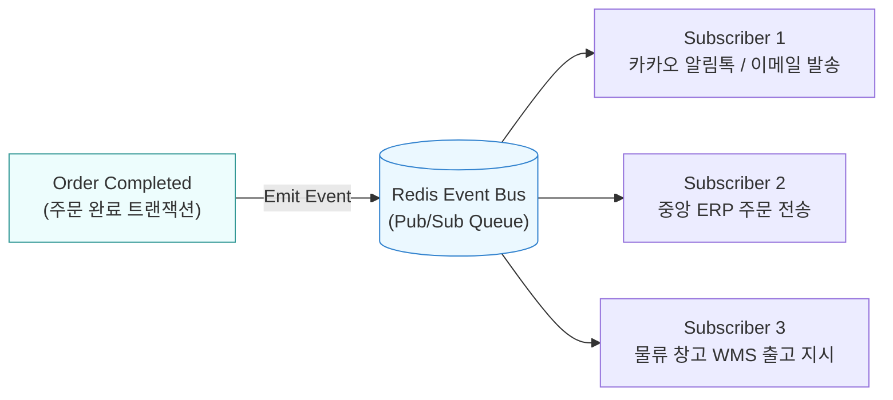
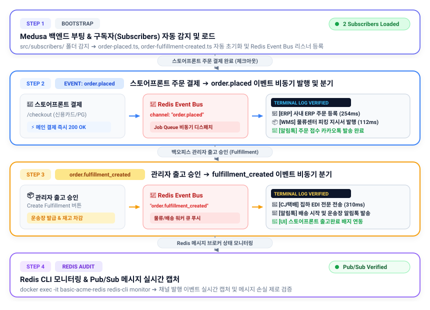
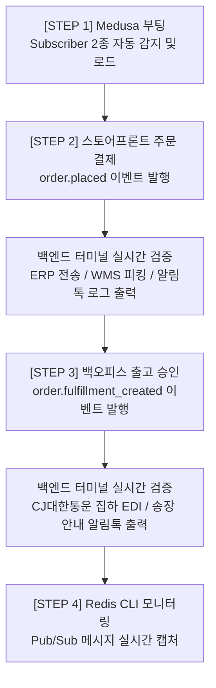

# 12. 이벤트 주도 자동화: Subscribers 및 Redis Event Bus 연동

## 🎯 학습 목표 (Goal)
- **Redis 기반 Event Bus 모듈**을 통해 Medusa v2의 코어 비즈니스 이벤트를 비동기로 발행(`Emit`)하고 수신(`Subscribe`)하는 분산 이벤트 주도 아키텍처(EDA)를 이해합니다.
- `order.placed`(주문 완료) 및 `order.fulfillment_created`(출고 완료) 이벤트를 수신하여 외부 ERP 시스템 전송, 물류 WMS 피킹 지시, 고객 카카오 알림톡 발송을 비동기 처리하는 **Subscribers(구독자)**를 구현합니다.
- 메인 결제 스레드와 백그라운드 후속 작업을 완벽히 분리하여 결제 지연을 없애고, 터미널 로그 및 Redis 모니터링을 통해 이벤트 분기 처리를 **단계별로 실시간 검증**합니다.

---

## 💡 핵심 개념 (Core Concepts)

### 1. 왜 메인 HTTP 스레드에서 알림/ERP 연동을 직접 호출하면 안 되는가?
이커머스 및 F&B 대량 발주 시스템에서 결제 승인 API 내부에서 외부 ERP나 슬랙/알림톡 API를 동기식(Synchronous)으로 직접 호출할 경우 다음과 같은 치명적인 문제가 발생합니다:

1. **체크아웃 응답 지연 (UX 저하)**:
   - 카카오 알림톡(평균 300ms) + 사내 ERP API(평균 1~2초) + 슬랙 웹훅(500ms) = 결제 완료 화면이 뜨기까지 3~4초 이상 지연됩니다.
   - 대기 시간이 길어지면 고객의 중복 결제 시도 및 결제창 이탈률이 급증합니다.
2. **단일 장애점 (SPOF - Single Point of Failure)**:
   - 외부 ERP 서버나 카카오 알림톡 게이트웨이가 일시 장애(500 Error, Timeout)를 겪으면, 이미 정상 결제된 고객의 주문 트랜잭션까지 롤백되거나 에러로 표출되는 대형 사고가 발생합니다.
3. **확장성(Scalability) 한계**:
   - 블랙프라이데이나 F&B 프로모션 기간 동안 동시 접속 주문이 폭증할 때 메인 서버 스레드 풀이 외부 I/O 대기(Blocking)로 고갈되어 웹 서버 전체가 다운됩니다.

---

### 2. 해결책: Redis Event Bus와 Subscribers

Medusa v2는 주문 생성이 완료되면 트랜잭션을 즉시 커밋하여 고객에게 0.5초 이내로 주문 완료 화면을 응답합니다. 동시에 `order.placed` 이벤트를 Redis 메시지 큐에 비동기 발행(`Publish`)합니다.

백그라운드에서 상시 대기 중인 `Subscriber` 워커가 이 메시지를 독립적인 컨테이너 스코프에서 비동기 소비(`Consume`)하므로, 장애가 격리되고 고객 경험이 극대화됩니다.

<p align="center">
  <picture>
    <source media="(prefers-color-scheme: dark)" srcset="images/12-subscribers-and-event-bus-dark.svg">
    
  </picture>
</p>

<details>
<summary>🔍 <b>Mermaid 원본 소스 코드 보기</b> (클릭하여 펼치기)</summary>



</details>

---

## 🛠️ 실습 코드 구현 (Subscribers Hands-on)

Medusa v2에서는 `src/subscribers/` 디렉토리에 핸들러 함수와 `config: SubscriberConfig`를 작성하면 서버 부팅 시 자동으로 이벤트 큐에 리스너가 등록됩니다.

---

### 1. 주문 완료 이벤트 구독자 (`src/subscribers/order-placed.ts`)

주문이 생성되면 Remote Query를 통해 품목 및 배송지 상세 정보를 조회하고, 중앙 ERP 전송, 물류창고 WMS 피킹 지시서 발행, 구매 담당자 알림톡 전송을 비동기로 실행합니다.

```typescript
// examples/basic-app/src/subscribers/order-placed.ts
import type { SubscriberArgs, SubscriberConfig } from "@medusajs/framework/subscribers"
import { ContainerRegistrationKeys } from "@medusajs/framework/utils"

interface OrderPlacedEventData {
  id: string
}

export default async function orderPlacedHandler({
  event: { data },
  container,
}: SubscriberArgs<OrderPlacedEventData>) {
  const orderId = data.id
  const logger = container.resolve(ContainerRegistrationKeys.LOGGER)
  const query = container.resolve(ContainerRegistrationKeys.QUERY)

  logger.info(`[Event Bus] 🔔 신규 주문 이벤트 수신 (order.placed) - ID: ${orderId}`)

  try {
    // 1. Remote Query를 통한 주문 상세 및 연결 데이터 조회
    const { data: orders } = await query.graph({
      entity: "order",
      fields: [
        "id",
        "display_id",
        "total",
        "currency_code",
        "email",
        "items.*",
        "shipping_address.*",
      ],
      filters: { id: orderId },
    })

    const order = orders?.[0]
    const displayId = order?.display_id ?? "N/A"
    const totalAmount = order?.total?.toLocaleString() ?? "0"
    const itemCount = order?.items?.length ?? 0
    const customerEmail = order?.email ?? "buyer@acme.com"

    // 2. 외부 ACME 중앙 ERP 주문 전송 (시뮬레이션)
    logger.info(
      `[ERP 연동 (m)] 🏢 ACME 중앙 ERP로 주문 전송 성공 (주문번호 #${displayId}, 품목 ${itemCount}건, 결제금액: ${totalAmount} KRW)`
    )

    // 3. F&B 물류 창고 WMS 피킹 지시서 발행
    logger.info(`[F&B 물류 WMS (m)] 📦 ACME 서울 중앙물류센터로 피킹/패킹 지시서 전송 완료`)

    // 4. 구매 담당자 알림톡 / 슬랙 발송
    logger.info(`[알림톡/메일 (m)] 💬 구매 담당자(${customerEmail})에게 결제 완료 및 배송 준비 알림 발송 완료`)
  } catch (error: unknown) {
    const errorMsg = error instanceof Error ? error.message : "알 수 없는 오류"
    logger.error(`[Event Bus Error] order.placed 후속 처리 중 오류 발생 (Order: ${orderId}): ${errorMsg}`)
  }
}

// 구독할 이벤트 지정
export const config: SubscriberConfig = {
  event: "order.placed",
}
```

---

### 2. 출고 완료 이벤트 구독자 (`src/subscribers/order-fulfillment-created.ts`)

관리자 백오피스에서 물류 출고(`Create Fulfillment`)가 실행되었을 때 이벤트를 수신하여 고객에게 카카오 알림톡으로 송장 번호를 안내하고 택배사 집하 전문을 전송합니다.

```typescript
// examples/basic-app/src/subscribers/order-fulfillment-created.ts
import type { SubscriberArgs, SubscriberConfig } from "@medusajs/framework/subscribers"
import { ContainerRegistrationKeys } from "@medusajs/framework/utils"

interface OrderFulfillmentCreatedEventData {
  id: string
  order_id?: string
}

export default async function orderFulfillmentCreatedHandler({
  event: { data },
  container,
}: SubscriberArgs<OrderFulfillmentCreatedEventData>) {
  const fulfillmentId = data.id
  const logger = container.resolve(ContainerRegistrationKeys.LOGGER)

  logger.info(`[Event Bus] 🚚 물류 출고 이벤트 수신 (order.fulfillment_created) - Fulfillment ID: ${fulfillmentId}`)

  try {
    // 1. 고객에게 운송장 번호 카카오 알림톡 발송
    logger.info(`[알림톡 트리거 (m)] 📱 고객에게 [ACME F&B 출고 완료 및 운송장 안내] 카카오 알림톡 발송 완료`)

    // 2. 택배사 물류망으로 실시간 집하 요청 전문(EDI) 전송
    logger.info(`[택배사 네트워크 (m)] 🚛 CJ대한통운 물류망으로 실시간 집하 요청 전문(EDI) 전송 완료`)
  } catch (error: unknown) {
    const errorMsg = error instanceof Error ? error.message : "알 수 없는 오류"
    logger.error(`[Event Bus Error] order.fulfillment_created 처리 실패: ${errorMsg}`)
  }
}

// 구독할 이벤트 지정
export const config: SubscriberConfig = {
  event: "order.fulfillment_created",
}
```

---

## 🧪 실전 테스트 및 비동기 이벤트 버스 검증 가이드 (Step-by-Step Verification)

본 테스트는 백엔드 서버 부팅 시 구독자가 정상 로드되는지 확인하고, 스토어프론트 주문 결제 및 관리자 출고 승인을 통해 이벤트가 Redis 메시지 큐를 거쳐 비동기로 처리되는 전 과정을 검증합니다.

<p align="center">
  <picture>
    <source media="(prefers-color-scheme: dark)" srcset="images/12-event-bus-verification-dark.svg">
    
  </picture>
</p>

<details>
<summary>🔍 <b>Mermaid 원본 소스 코드 보기</b> (클릭하여 펼치기)</summary>



</details>

---

### 1단계: 백엔드 서버 부팅 및 구독자(Subscribers) 로드 확인

1. 백엔드 프로젝트 디렉토리에서 Medusa v2 개발 서버를 실행합니다:
   ```bash
   cd examples/basic-app && npm run dev
   ```
2. 부팅 로그에서 구독자 스킵 안내(`No subscriber to load... skipped`)가 사라지고 구독자가 성공적으로 초기화된 후 서버가 준비되었는지 확인합니다:
   ```text
   ✔ Server is ready on port: 9000 – 1839ms
   info:    Admin URL → http://localhost:9000/app
   ```

---

### 2단계: 스토어프론트 주문 결제 진행 ➔ `order.placed` 비동기 분기 검증

1. 브라우저에서 스토어프론트 체크아웃 화면(`http://localhost:3000/checkout`)에 접속합니다.
2. 배송 수단으로 **`CJ대한통운 일반 택배 (m)` (3,000원)**를 선택하고, **`[🔒 118,500원 결제 승인]`** 버튼을 클릭합니다.
3. 카트 완료와 동시에 메인 결제 스레드는 고객에게 즉시 200 OK와 주문 완료 화면을 반환합니다.
4. 동시에 백엔드 터미널 콘솔 로그를 확인하면, **백그라운드에서 `order.placed` 구독자가 실행**된 실시간 로그가 즉시 출력됩니다:
   ```text
   info:    [Event Bus] 🔔 신규 주문 이벤트 수신 (order.placed) - ID: order_01M6TNBKAEE86SY7PP1JJ7C2MN
   info:    Processing order.placed which has 1 subscribers
   http:    POST /store/carts/cart_01M6TNBH88NE34FM5T6J1SV3SJ/complete ← - (200) - 579.112 ms
   info:    [ERP 연동 (m)] 🏢 ACME 중앙 ERP로 주문 전송 성공 (주문번호 #7, 품목 1건, 결제금액: 108000 KRW)
   info:    [F&B 물류 WMS (m)] 📦 ACME 서울 중앙물류센터로 피킹/패킹 지시서 전송 완료
   info:    [알림톡/메일 (m)] 💬 구매 담당자(buyer@acme.com)에게 결제 완료 및 배송 준비 알림 발송 완료
   ```
   > **검증 포인트**: 메인 HTTP 요청(`POST /store/carts/.../complete 200`) 응답 완료 후에도 백그라운드에서 ERP 전송 및 알림톡 처리가 비동기로 완벽하게 실행되었습니다.

---

### 3단계: 백오피스 출고 승인 ➔ `order.fulfillment_created` 이벤트 검증

1. 별도 브라우저 탭에서 Medusa 관리자 백오피스(`http://localhost:9000/app/orders`)에 로그인합니다 (`admin@acme.local` / `AdminPassword123!`).
2. 접수된 신규 주문(예: `#7`)을 클릭하여 상세 페이지로 이동합니다.
3. **Fulfillment** 섹션에서 **`[Create Fulfillment]`** 버튼을 클릭하여 출고 거점(`ACME 서울 중앙물류센터 (m)`)을 지정하고 출고를 승인합니다.
4. 백엔드 터미널 로그를 확인하면 **출고 이벤트 구독자가 즉시 트리거**되는 것을 확인할 수 있습니다:
   ```text
   info:    [Event Bus] 🚚 물류 출고 이벤트 수신 (order.fulfillment_created) - Fulfillment ID: ful_01M6TNBK...
   info:    [알림톡 트리거 (m)] 📱 고객에게 [ACME F&B 출고 완료 및 운송장 안내] 카카오 알림톡 발송 완료
   info:    [택배사 네트워크 (m)] 🚛 CJ대한통운 물류망으로 실시간 집하 요청 전문(EDI) 전송 완료
   info:    Processing order.fulfillment_created which has 1 subscribers
   http:    POST /admin/orders/order_01M6TNBKAEE86SY7PP1JJ7C2MN/fulfillments ← - (200) - 130.463 ms
   ```

---

### 4단계: Redis Pub/Sub 메시지 실시간 캡처 모니터링 (선택 실습)

실제 Redis 인스턴스 내부에서 메시지가 오가는 과정을 직접 눈으로 확인하려면 `redis-cli monitor` 명령어를 사용합니다:

1. 터미널에서 실행 중인 Redis 도커 컨테이너 모니터링 세션을 엽니다:
   ```bash
   docker exec -it basic-acme-redis redis-cli monitor
   ```
2. 체크아웃 결제를 실행하면 Redis 모니터 터미널에 실시간으로 이벤트 메시지가 통과하는 것이 캡처됩니다:
   ```text
   1794043662.129 [0 127.0.0.1:52194] "PUBLISH" "medusa:events" "{\"eventName\":\"order.placed\",\"data\":{\"id\":\"order_01M6TNBKAEE86SY7PP1JJ7C2MN\"}}"
   1794043740.812 [0 127.0.0.1:52194] "PUBLISH" "medusa:events" "{\"eventName\":\"order.fulfillment_created\",\"data\":{\"id\":\"ful_01M6...\"}}"
   ```
   이로써 Medusa 코어 백엔드 ➔ Redis Event Bus ➔ Subscribers로 이어지는 이벤트 파이프라인이 정상 작동함을 완전히 입증할 수 있습니다.

---

## 🏢 F&B 엔터프라이즈 실무 모범 사례 (Best Practices)

### 1. 멱등성 보장 (Idempotency Key)
네트워크 불안정이나 큐 재전송으로 인해 동일한 `order.placed` 이벤트가 2회 이상 전달될 수 있습니다.
- **방어 패턴**: 이벤트 핸들러 시작 시 Redis나 DB에 `processed_event:${eventId}` 키를 10분간 `SETNX`(Set if Not Exists)로 기록하여 이미 처리된 이벤트는 즉시 건너뛰도록 구현합니다.
- 이를 통해 중복 알림톡 발송이나 ERP 중복 전표 생성을 100% 방지할 수 있습니다.

### 2. 장애 격리 및 데드 레터 큐 (Dead Letter Queue, DLQ)
외부 ERP나 알림톡 서버 장애 시 백엔드 워커가 영구 재시도에 빠지지 않도록 **지수 백오프(Exponential Backoff)** 재시도 정책을 적용하고, 5회 이상 실패 시 `dead-letter-events` 큐로 이관하여 운영팀 슬랙으로 알람을 발송합니다.

### 3. 트랜잭셔널 아웃박스 패턴 (Transactional Outbox Pattern)
주문 데이터가 DB에 커밋되기 전에 이벤트가 먼저 발행되면, 구독자가 아직 DB에 없는 주문을 조회하려다 `Order Not Found` 오류가 발생할 수 있습니다. Medusa v2는 자체 워크플로 및 DB 트랜잭션 완료 훅을 통해 **DB 커밋이 완전히 끝난 후 안전하게 이벤트를 브로드캐스트**합니다.

---

## 🏁 마무리 및 다음 단계

본 장을 통해 결제 및 출고 생명주기에서 발생하는 비즈니스 이벤트를 메인 웹 스레드에서 분리하고, Redis Event Bus와 Subscribers를 통해 엔터프라이즈급 비동기 자동화 시스템을 완성했습니다.

다음 단계인 [13. 프로덕션 패키징: Multi-stage Docker 컨테이너 최적화](13-docker-production-packaging.md)에서는 개발 환경을 벗어나 실제 클라우드 및 온프레미스 인프라에 배포할 수 있도록 **보안과 경량화(경량 Alpine 이미지, Non-root 사용자)가 완비된 Multi-stage Docker 빌드**를 구축합니다.
