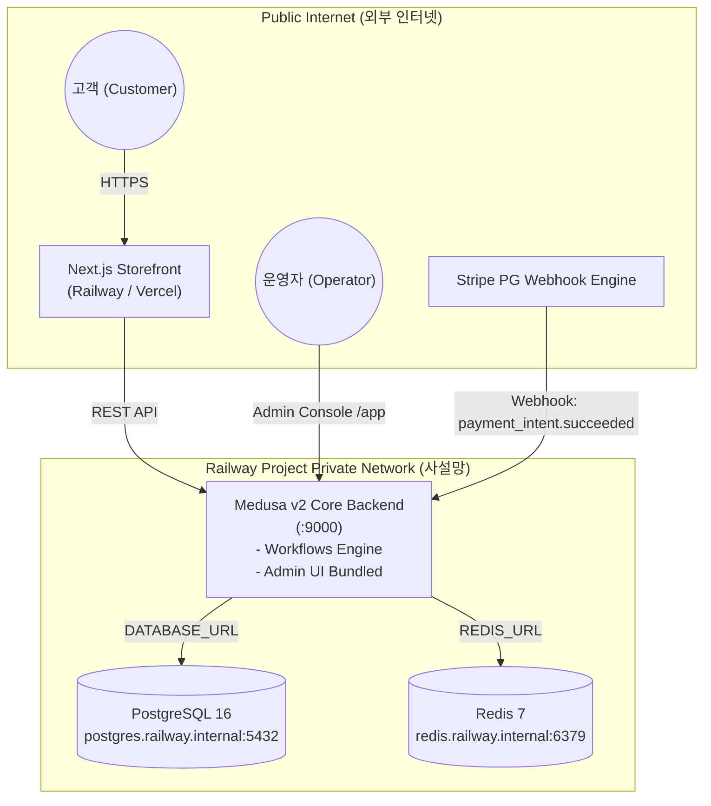

# 14. Railway 프로덕션 클라우드 배포 및 실무 운영 가이드

## 🎯 학습 목표 (Goal)
- Medusa v2 백엔드와 관리자 대시보드(Admin), PostgreSQL, Redis를 글로벌 PaaS인 **Railway**에 원클릭/CLI 기반으로 안전하게 배포합니다.
- 사설망(Private Networking)을 통한 데이터베이스 연동, 시작 스크립트(`entrypoint.sh`)를 통한 마이그레이션 자동화, 헬스체크 및 실전 트러블슈팅 역량을 확보합니다.

---

## 💡 핵심 개념 (Core Concepts)

### 왜 Medusa v2 배포에 Railway인가?
Medusa v2는 일반적인 정적 웹사이트나 무상태(Stateless) 서버리스와 달리 다음과 같은 인프라 요구조건을 가집니다:
1. **지속 프로세스(Long-running Node.js Process)**: 이벤트 버스 리스너와 워크플로 대기열을 처리하기 위해 서버가 상시 가동되어야 합니다.
2. **전용 PostgreSQL 및 Redis 인프라**: 관계형 데이터 및 비동기 메시지 브로커가 필요합니다.
3. **사설 네트워크(Private Networking)**: DB와 Redis가 공용 인터넷에 노출되지 않고, 내부 고속 사설망(`*.railway.internal`)으로 백엔드와 통신해야 보안과 지연시간(Latency)을 모두 잡을 수 있습니다.

Railway는 Dockerfile 기반의 자동 컨테이너 빌드, Managed PostgreSQL 및 Redis 원클릭 추가, 변수 참조(Variable Reference) 기능을 네이티브로 제공하여 Medusa 공식 팀에서도 가장 강력히 권장하는 인프라입니다.

---

## 🏗️ Railway 배포 아키텍처 토폴로지

<p align="center">
  <picture>
    <source media="(prefers-color-scheme: dark)" srcset="images/14-railway-topology-dark.svg">
    
  </picture>
</p>

<details>
<summary>🔍 <b>Mermaid 원본 소스 코드 보기</b> (클릭하여 펼치기)</summary>



</details>

---

## 🛠️ 실습 단계: Railway 원클릭 & CLI 배포 완전 정복

### [1단계] Railway CLI 설치 및 프로젝트 생성

터미널에서 Railway 전용 CLI를 설치하고 로그인합니다.

```bash
# 1. Railway CLI 전역 설치
npm install -g @railway/cli

# 2. 브라우저 인증을 통한 로그인
railway login

# 3. 배포할 Medusa 프로젝트 루트 경로로 이동
cd examples/basic-app

# 4. 신규 Railway 프로젝트 초기화
railway init
# 프롬프트: "Create a new project" 선택 -> 프로젝트 이름 입력 (예: acme-commerce-prod)
```

---

### [2단계] PostgreSQL 및 Redis 데이터베이스 추가

Railway에서는 별도의 외부 DB 서비스(Supabase, Upstash 등)에 가입할 필요 없이, 프로젝트 내부에 엔터프라이즈급 DB를 원클릭으로 프로비저닝할 수 있습니다.

```bash
# PostgreSQL 16 플러그인 추가
railway add -d postgres

# Redis 7 플러그인 추가
railway add -d redis
```

> **[원리] Railway Variable Reference(변수 참조)**:
> Railway는 데이터베이스가 생성되면 `${{Postgres.DATABASE_URL}}`과 `${{Redis.REDIS_URL}}`이라는 동적 환경 변수를 프로젝트 내에 자동 등록합니다. 이 주소는 외부 인터넷을 거치지 않는 초고속 사설망 IP(`*.railway.internal`)를 가리킵니다.

---

### [3단계] 컨테이너 시작 자동화 스크립트 (`entrypoint.sh`) 구성

프로덕션 컨테이너가 부팅될 때:
1. DB가 완전히 준비될 때까지 대기
2. `npx medusa db:migrate` 자동 실행
3. 최초 관리자 계정 생성
4. 서버 프로세스 바인딩

이 모든 과정을 완벽히 조율하는 `entrypoint.sh`를 작성합니다.

```bash
#!/bin/sh
set -e

echo "🚀 [ACME Medusa v2] Railway 부팅 시퀀스 시작..."

# 1. PostgreSQL 연결 확인 (최대 30초 대기)
counter=0
until node -e "
const { Client } = require('pg');
const client = new Client({ connectionString: process.env.DATABASE_URL });
client.connect()
  .then(() => { client.end(); process.exit(0); })
  .catch(() => process.exit(1));
" 2>/dev/null; do
  counter=$((counter + 1))
  if [ $counter -gt 30 ]; then
    echo "❌ 데이터베이스 연결 시간 초과"
    exit 1
  fi
  echo "   PostgreSQL 대기 중 ($counter/30)..."
  sleep 1
done
echo "✅ 데이터베이스 연결 완료."

# 2. Medusa 데이터베이스 마이그레이션 실행
echo "🔄 데이터베이스 마이그레이션 적용 중..."
npx medusa db:migrate
echo "✅ 마이그레이션 완료."

# 3. 최초 관리자 계정 생성 (선택 사항)
if [ -n "$MEDUSA_ADMIN_EMAIL" ] && [ -n "$MEDUSA_ADMIN_PASSWORD" ]; then
  echo "👤 관리자 계정 초기화 확인 중..."
  npx medusa user --email "$MEDUSA_ADMIN_EMAIL" --password "$MEDUSA_ADMIN_PASSWORD" 2>/dev/null || true
fi

# 4. 서버 프로세스 실행
echo "🌐 Medusa 프로덕션 서버 구동..."
exec npm run start
```

실행 권한을 부여합니다:
```bash
chmod +x entrypoint.sh
```

---

### [4단계] Railway 매니페스트 명세 (`railway.json`)

Railway 빌드 엔진에 Dockerfile 위치와 헬스체크 정책을 명시합니다.

```json
{
  "$schema": "https://railway.app/railway.schema.json",
  "build": {
    "builder": "DOCKERFILE",
    "dockerfilePath": "Dockerfile"
  },
  "deploy": {
    "startCommand": "./entrypoint.sh",
    "healthcheckPath": "/health",
    "healthcheckTimeout": 120,
    "restartPolicyType": "ON_FAILURE",
    "restartPolicyMaxRetries": 5
  }
}
```

- `healthcheckTimeout: 120`: 최초 부팅 시 마이그레이션이 실행되는 시간을 감안하여 120초 동안 헬스체크 실패 판정을 유예합니다.
- `restartPolicyType: ON_FAILURE`: 예기치 못한 크래시 발생 시 자동 복구(Auto-restart)합니다.

---

### [5단계] Railway 대시보드 필수 환경 변수 설정

Railway 대시보드의 백엔드 서비스 > **Variables** 탭에 아래 값을 입력합니다.

| 환경 변수 키 | 값 (또는 참조 문법) | 설명 |
| :--- | :--- | :--- |
| `NODE_ENV` | `production` | 프로덕션 모드 활성화 |
| `PORT` | `9000` | 내부 컨테이너 포트 |
| `DATABASE_URL` | `${{Postgres.DATABASE_URL}}` | Railway 사설 Postgres 주소 참조 |
| `REDIS_URL` | `${{Redis.REDIS_URL}}` | Railway 사설 Redis 주소 참조 |
| `JWT_SECRET` | `supersecret-acme-jwt-token-railway-prod-2026` | 최소 32자 이상의 임의 문자열 |
| `COOKIE_SECRET` | `supersecret-acme-cookie-key-railway-prod-2026` | 세션 암호화 키 |
| `STORE_CORS` | `https://store.acme.com,https://acme-storefront.up.railway.app` | 프론트엔드 도메인 허용 |
| `ADMIN_CORS` | `https://<YOUR_BACKEND>.up.railway.app` | 어드민 대시보드 허용 |
| `AUTH_CORS` | `https://store.acme.com,https://<YOUR_BACKEND>.up.railway.app` | 인증 허용 도메인 |
| `MEDUSA_ADMIN_EMAIL` | `admin@acme.local` | 최초 부팅 시 생성할 관리자 이메일 |
| `MEDUSA_ADMIN_PASSWORD` | `AcmeAdminSecurePass2026!` | 최초 관리자 패스워드 |

---

### [6단계] 공개 도메인 생성 및 배포 실행

```bash
# 1. 외부 접근용 공개 도메인 생성 (*.up.railway.app)
railway domain

# 2. 현재 소스 코드 배포 실행
railway up
```

배포가 완료되면 터미널에 생성된 공개 URL(예: `https://acme-commerce-prod.up.railway.app`)이 출력됩니다.
브라우저에서 `https://acme-commerce-prod.up.railway.app/app`에 접속하여 관리자 로그인을 진행할 수 있습니다.

---

## ⚡ 실전 운영 트러블슈팅 가이드

### 1. 배포 직후 `Deployment failed: Healthcheck timed out` 오류
- **원인**: 최초 배포 시 테이블 마이그레이션이 진행 중인데 Railway 헬스체크 타임아웃(기본 30초)이 초과되어 컨테이너가 강제 종료됨.
- **해결책**: `railway.json`의 `healthcheckTimeout`을 `120` 또는 `180`으로 늘려줍니다.

### 2. 스토어프론트에서 `CORS Error` 발생
- **원인**: `STORE_CORS` 환경 변수에 프론트엔드 배포 도메인의 프로토콜(`https://`)이 누락되었거나 끝에 슬래시(`/`)가 포함된 경우.
- **해결책**: 슬래시 없이 정확히 도메인만 명시: `https://my-storefront.vercel.app`

### 3. 영구 파일 스토리지 (Ephemeral Filesystem 대응)
- **원인**: Railway 컨테이너는 재배포 시 로컬 디렉터리가 초기화되므로, 상품 이미지 업로드 시 컨테이너 로컬 디스크에 저장하면 재배포 후 이미지가 유실됩니다.
- **해결책**: **Cloudflare R2** 또는 **AWS S3**와 연동하는 Medusa File Provider 플러그인을 사용하여 외부 오브젝트 스토리지로 이미지를 분리 저장합니다.

---

## 🏁 마무리
축하합니다! 이제 엔터프라이즈 요구조건을 충족하는 Medusa v2 백엔드가 Railway의 고성능 사설망과 컨테이너 오케스트레이션 환경에 완벽히 배포되었습니다.
모든 변경사항은 GitHub 메인 브랜치 푸시 또는 `railway up` 명령을 통해 무중단으로 자동 배포됩니다.
